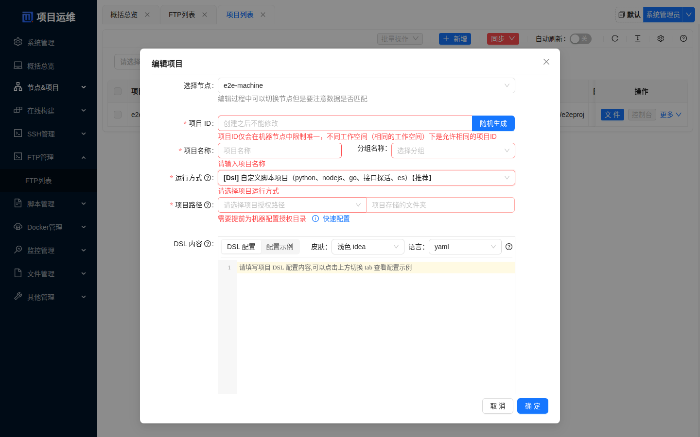
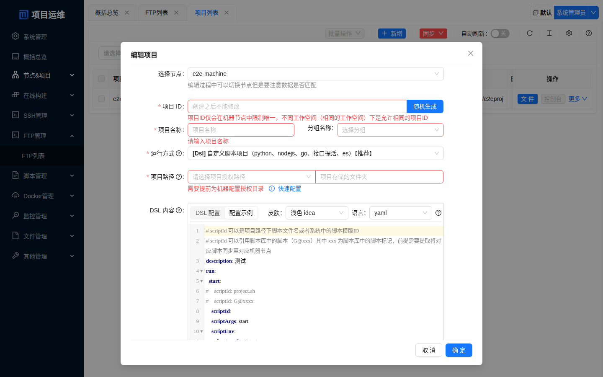
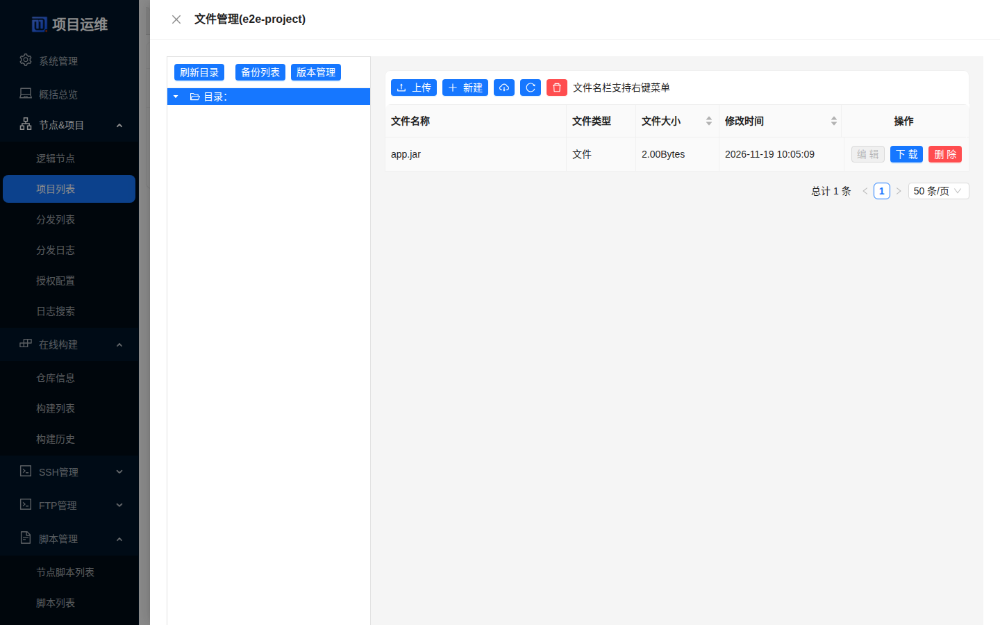

## 前言

Nginx 不是「Jar 进程」，没有统一的管理命令入口（发行版、编译参数不同），
用 Jpom 的 **Dsl 运行方式** 包一层脚本，就能在网页上启动 / 停止 / 重载 / 看状态，还能在线编辑 `.conf` 后自动重载。

> 本文按 **2.11.x** 的 DSL 写法（YAML + scriptId）讲解。
> 如果你的 Jpom 是 2.9 及更早版本，写法不同，请对照[DSL 说明](/pages/FQA/DSL/)末尾的迁移表。

## 需要准备的环境

1. Jpom 服务端 + 插件端（插件端装在有 nginx 的那台机器上）
2. 目标服务器已安装 nginx，并知道两个路径：
   - nginx 可执行文件：`which nginx`（如 `/usr/sbin/nginx`）
   - nginx 前缀目录：`nginx -V` 里的 `--prefix=`（如 `/etc/nginx` 或 `/usr/local/nginx`）

::: tip 先确认这三条命令在你的服务器上能跑
```bash
nginx -v                 # 版本
nginx -t                 # 配置检查
ls $(nginx -V 2>&1 | sed -n 's/.*--prefix=\([^ ]*\).*/\1/p')/logs/nginx.pid
```
最后一条会输出 pid 文件路径，下面脚本里要用到。
:::

## 一、配置授权目录

Nginx 的 `conf` 目录要在 Jpom 的授权目录里，才能在线编辑配置：

【节点&项目】->【授权配置】里把 nginx 的 conf 目录（或它的上级目录）加进去。

::: warning 授权目录是安全边界
不建议直接把 `/` 或 `/etc` 加进授权目录。只授权真正需要 Jpom 管理的子目录。
:::

## 二、写节点脚本

【脚本管理】->【脚本列表】->【新增】，语言选 shell，内容如下。
保存后打开编辑弹窗即可看到 **scriptId**，下一步要用。

### Linux

```bash
#!/bin/bash
# nginx 可执行文件（用绝对路径，插件端的 PATH 可能不含 /usr/sbin）
NGINX_BIN="/usr/sbin/nginx"
# nginx 前缀目录，pid 与 conf 都在它下面
NGINX_HOME="/etc/nginx"

PID_FILE="${NGINX_HOME}/logs/nginx.pid"

master_pid() {
  # 优先用 pid 文件（最准）
  if [ -f "$PID_FILE" ]; then
    local pid
    pid=$(cat "$PID_FILE" 2>/dev/null)
    if [ -n "$pid" ] && kill -0 "$pid" 2>/dev/null; then
      echo "$pid"
      return
    fi
  fi
  # 兜底：pgrep -o 取最早的进程，即 master 进程
  pgrep -o -x nginx 2>/dev/null
}

start() {
  local pid
  pid=$(master_pid)
  if [ -n "$pid" ]; then
    echo "nginx already running: $pid"
    return
  fi
  "$NGINX_BIN" -p "$NGINX_HOME" -c "${NGINX_HOME}/nginx.conf"
  sleep 1
  echo "started: $(master_pid)"
}

stop() {
  local pid
  pid=$(master_pid)
  if [ -z "$pid" ]; then
    echo "nginx is not running"
    return
  fi
  echo "stopping $pid"
  # quit = 优雅退出：处理完当前请求再退
  "$NGINX_BIN" -p "$NGINX_HOME" -c "${NGINX_HOME}/nginx.conf" -s quit
  for i in $(seq 1 10); do
    [ -z "$(master_pid)" ] && break
    sleep 1
  done
  pid=$(master_pid)
  [ -n "$pid" ] && kill -9 "$pid"
}

reload() {
  if [ -z "$(master_pid)" ]; then
    echo "nginx is not running, cannot reload"
    return 1
  fi
  "$NGINX_BIN" -p "$NGINX_HOME" -c "${NGINX_HOME}/nginx.conf" -s reload
  echo "reloaded"
}

status() {
  local pid
  pid=$(master_pid)
  if [ -n "$pid" ]; then
    echo "running:$pid"
  else
    echo "stopped"
  fi
}

case "$1" in
  start)  start  ;;
  stop)   stop   ;;
  reload) reload ;;
  restart) stop; start ;;
  status) status ;;
  *) echo "usage: $0 {start|stop|reload|restart|status}"; exit 1 ;;
esac
```

::: danger 为什么 status 一定要取「master 进程」的 PID
nginx 是 master + 多个 worker 的多进程模型。用 `ps -ef | grep nginx` 会拿到**一堆** PID，
拼成 `running:1 2 3` 这种格式 Jpom 解析不了，状态就会一直不对。
用 pid 文件或 `pgrep -o -x nginx` 只取 master 才是对的。
:::

### Windows

```bat
@echo off
set NGINX_HOME=%PROJECT_PATH%\..
set NGINX_BIN=%NGINX_HOME%\nginx.exe

if "%1"=="start"   goto start
if "%1"=="stop"    goto stop
if "%1"=="reload"  goto reload
if "%1"=="restart" goto restart
if "%1"=="status"  goto status
exit /b 1

:start
cd /d %NGINX_HOME%
start "" nginx
exit /b 0

:reload
cd /d %NGINX_HOME%
nginx -s reload
exit /b 0

:stop
cd /d %NGINX_HOME%
nginx -s quit
timeout /t 2 >nul
for /f "tokens=2" %%I in ('tasklist ^| findstr /i nginx.exe') do taskkill /F /PID %%I
exit /b 0

:restart
cd /d %NGINX_HOME%
nginx -s reload
exit /b 0

:status
set PID=
for /f "tokens=2" %%I in ('tasklist ^| findstr /i nginx.exe') do if not defined PID set PID=%%I
if defined PID (echo running:%PID%) else (echo stopped)
exit /b 0
```

::: tip Windows 的取 PID 写法
上面用「取 tasklist 第一行匹配结果」的办法拿到一个 PID，避免输出多个 PID。
老版本文档里那个 `:start` 标签重复定义（`:reload` 写成了 `:start`）的 bug 已修正。
:::

## 三、创建 DSL 项目

【节点&项目】->【项目列表】->【+ 新增】-> 选节点 -> 运行方式选 **Dsl**：

```yaml
description: NGINX 管理
run:
  start:
    scriptId: 你的脚本ID
    scriptArgs: start
  status:
    scriptId: 你的脚本ID
    scriptArgs: status
  stop:
    scriptId: 你的脚本ID
    scriptArgs: stop
  reload:
    scriptId: 你的脚本ID
    scriptArgs: reload
  restart:
    scriptId: 你的脚本ID
    scriptArgs: reload     # nginx 的「重启」用 reload 更平滑
  fileChangeReload: true   # 改完 .conf 自动 reload
```



**项目路径**建议指向 nginx 的 `conf` 目录（或其上级），这样可以直接在 Jpom 里编辑配置文件。

保存后如果想对照官方模板，可以切到【配置示例】选项卡：



::: danger 保存时会被校验
`run.status` 必须存在，否则保存报「没有配置 run.status」。
`fileChangeReload` 只有在同时配了 `reload` 流程时才生效。
:::

## 四、日常使用

| 操作 | Jpom 实际执行 |
| --- | --- |
| 启动 | `run.start` → `script.sh start` |
| 停止 | `run.stop` → `script.sh stop` |
| 重载 | `run.reload` → `script.sh reload` |
| 改配置文件 | 在【文件】里编辑 `.conf` → 保存触发文件变动 → 自动执行 reload |

在【项目列表】行内点【文件】进入项目文件管理，就能直接编辑 nginx 配置文件：



::: tip 让 .conf 可以直接编辑
把 `conf` 加到可编辑后缀里（否则只能下载不能改）：
【节点&项目】->【授权配置】，或在资产机器详情里配置可编辑后缀，加一行 `conf`。
:::

## 五、常见问题

**Q：启动报 `nginx: [emerg] open() "/var/log/nginx/error.log" failed`**

A：脚本里用了非 root 用户执行（插件端进程的用户）。要么把日志目录权限给该用户，要么改用 `nginx -p` 指定前缀。

**Q：状态一直「未运行」，但 nginx 明明在跑**

A：`status` 输出的不是单个 `running:<数字>`。检查是不是 `ps | grep` 拿到多个 PID，或 pid 文件路径写错。

**Q：改了配置没自动生效**

A：① `fileChangeReload: true` 有没有开；② `run.reload` 有没有配；③ 文件是否真的保存成功（看文件管理的修改时间）。

**Q：`nginx -t` 报配置语法错误**

A：这是 nginx 自己的检查，和 Jpom 无关。建议在 `reload` 前加一步 `nginx -t` 校验，失败就不 reload：

```bash
reload() {
  "$NGINX_BIN" -p "$NGINX_HOME" -c "$NGINX_HOME/nginx.conf" -t || { echo "config test failed"; return 1; }
  "$NGINX_BIN" -p "$NGINX_HOME" -c "$NGINX_HOME/nginx.conf" -s reload
}
```

## 相关文档

- [DSL 说明与典型场景](/pages/FQA/DSL/)
- [DSL 配置详解](/pages/dsl-config/)
- [DSL 常见问题与排查](/pages/9c85bc/)
- [用 DSL 管理 Tomcat](/pages/practice/dc2836/)
- [用 DSL 管理 Elasticsearch](/pages/practice/8017a2/)
