::: danger 版本说明：本文是 2.9.13 的 DSL 写法
2.10 起 DSL 已改为 **YAML 配置**（`run.start / status / stop` + `scriptId`），2.11.x 延续该写法。
本文中的老写法在当前版本**不能直接照抄**，请对照：

- [DSL 说明与典型场景](/pages/FQA/DSL/)
- [DSL 配置详解](/pages/dsl-config/)
- [管理 Java 项目脚本示例（含 JDK 版本）](/pages/519020/)
- [DSL 项目接口探活监控（2.11 版）](/pages/practice/610387/)

（本文保留原样，仅供老版本对照与迁移参考。）
:::

## 前言

本文主要介绍如果使用 DSL 模式的项目来实现接口探活管理项目运行状态

> 本文中服务端和插件端是安装在同一个服务器中的，实际操作时根据业务情况来安装
>
> 文中使用到的依赖环境版本仅供参考，实际使用中请根据业务情况来安装对应的版本

> 注意：本文采用一键安装同时基于 2.9.13 版本讲解,系统为 centos

## 需要准备的环境

1. Jpom 服务端
   1. 安装 jpom 需要 java 环境
   2. 构建需要 maven 环境
2. Jpom 插件端
   1. 安装 jpom 需要 java 环境
3. 一个代码仓库（案例中使用 java 项目）

### 安装插件端推荐命令

> 推荐命令会自动检查环境中是否存在 jdk 如果不存在将自动安装 jdk
>
> 一般情况建议自行安装，如果不需要自动安装删除命令最后的 `jdk` 即可

```shell
# 安装插件端和 jdk 环境
yum install -y wget && \
wget -O install.sh https://jpom.top/docs/install.sh && \
bash install.sh Agent jdk
```

### 安装服务端推荐命令

> 推荐命令会自动检查环境中是否存在 jdk 和 maven 如果不存在将自动安装 jdk 和 maven
> 
> 一般情况建议自行安装，如果不需要自动安装删除命令最后的 `jdk+mvn` 即可

```shell
# 安装服务端和 jdk、maven 环境
yum install -y wget && \
wget -O install.sh https://jpom.top/docs/install.sh && \
bash install.sh Server jdk+mvn
```

::: tip 😋
案例就默认您已经安装好上述环境（jpom 插件端、jpom 服务端、maven 插件）
:::

::: tip 😋
案例就默认您已经初始好服务端并且配置了节点
:::

::: danger 😋
如果对安装流程和初始化流程不是了解有疑问的可以参考其他[实践案例](/pages/practice/)和[安装说明文档](/pages/install/)
:::

## 配置 DSL 脚本

这里的脚本是为了能控制项目的启动、停止、获取项目状态

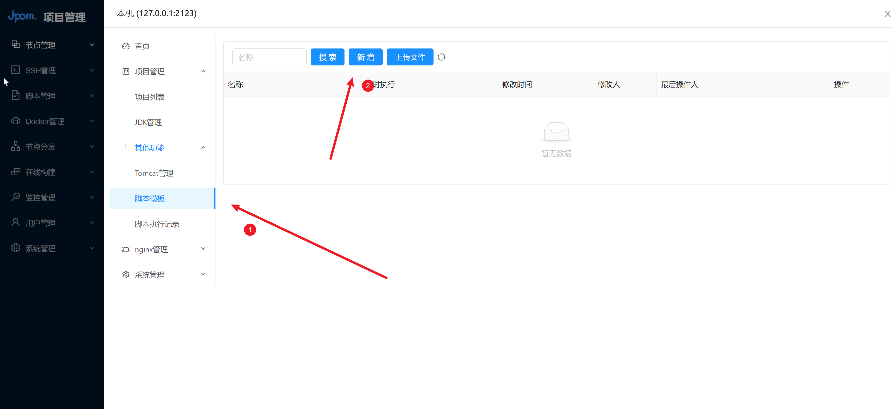

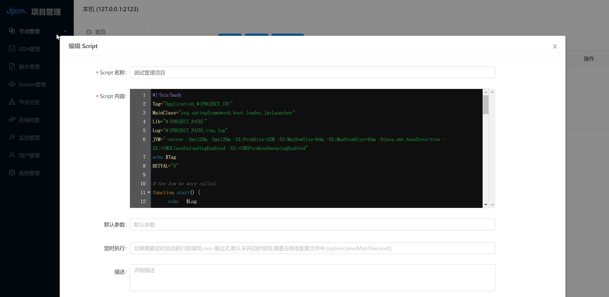

### 脚本内容

```shell
#!/bin/bash
Tag="Application_${PROJECT_ID}"
MainClass="org.springframework.boot.loader.JarLauncher"
Lib="${PROJECT_PATH}"
Log="${PROJECT_PATH}/run.log"
JVM="-server -Xms128m -Xmx128m -XX:PermSize=32M -XX:MaxNewSize=64m -XX:MaxPermSize=64m -Djava.awt.headless=true -XX:+CMSClassUnloadingEnabled -XX:+CMSPermGenSweepingEnabled"
echo $Tag
RETVAL="0"

# See how we were called.
function start() {
    echo  $Log 
    if [ ! -f $Log ]; then
        touch $Log
    fi
    nohup java $JVM -Dappliction=$Tag -Djava.ext.dirs=$Lib":${JAVA_HOME}/jre/lib/ext" $MainClass > $Log 2>&1 &
	sleep 3
    head -n 10 $Log
}


function stop() {
    pid=$(ps -ef | grep -v 'grep' | egrep $Tag| awk '{printf $2 " "}')
    if [ "$pid" != "" ]; then      
        echo -n "boot ( pid $pid) is running" 
        echo 
        echo -n $"Shutting down boot: "
        pid=$(ps -ef | grep -v 'grep' | egrep $Tag| awk '{printf $2 " "}')
        if [ "$pid" != "" ]; then
            echo "kill boot process"
            kill -9 "$pid"
        fi
        else 
             echo "boot is stopped" 
        fi

    status
}

function get_json_value()
{
  local json=$1
  local key=$2
  local value=$(echo "${json}" | awk -F "[{,:}]" '{for(i=1;i<=NF;i++){if($i~"'${key}'"){print $(i+1)}}}' | sed 's/\"//g') 
  echo ${value}
}

function status()
{
   #  这里的端口或者url 路径需要跟进您的项目端口和获取项目状态的接口来定
    result_msg=$(curl -s -X GET --header 'Accept: application/json' --connect-timeout 1 -m 1 'http://127.0.0.1:8084')
    echo "running:`get_json_value "${result_msg}" "pid"`"
}

# See how we were called.
RETVAL="0"
case "$1" in
    start)
        start
        ;;
    stop)
        stop
        ;;
    status)
        status
        ;;
    *)
      usage
      ;;
esac

exit $RETVAL

```

### 关于脚本的几个说明

可以查阅 [DSL 脚本的基础介绍](/pages/FQA/DSL/)了解基础使用规则

1. 案例中是管理 Java 项目，实际中可以跟进自己的需求调整脚本内容来管理其他项目
2. 注意在使用过 status 方法中修改为当前项目的端口号，url 地址。
3. status 请求项目的 url 地址中建议返回当前项目的进程号（pid）
4. curl 请求超时时间不要过长，建议控制在 `1 秒`。因为获取项目状态是`串行执行`，如果单个项目 status 执行耗时过大会影响查看节点项目状态相关功能

## 配置项目

### 配置项目授权（白名单）

用于控制项目存储的目录，[更多说明](/pages/FQA/proper-noun/)

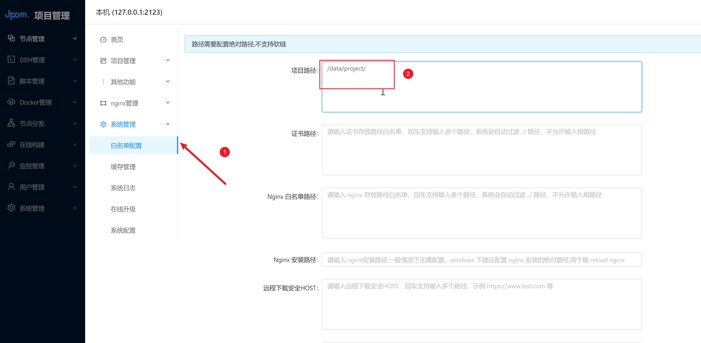

### 创建项目

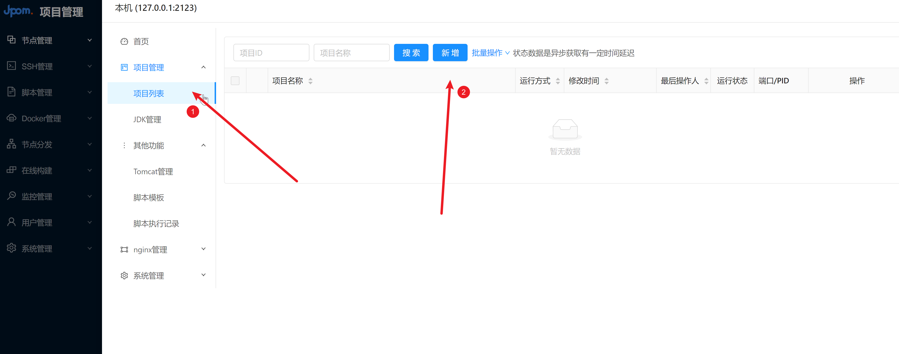

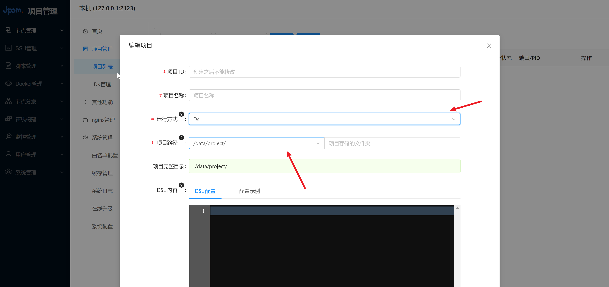

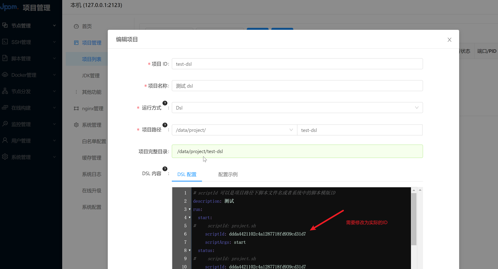

DSL 配置内容：

```yaml
# scriptId 可以是项目路径下脚本文件名或者系统中的脚本模版ID
description: 测试
run:
  start:
#    scriptId: project.sh
    scriptId: ddda4421102c4a1287718fd939cd31d7
    scriptArgs: start
  status:
#    scriptId: project.sh
    scriptId: ddda4421102c4a1287718fd939cd31d7
    scriptArgs: status
  stop:
#    scriptId: project.sh
    scriptId: ddda4421102c4a1287718fd939cd31d7
    scriptArgs: stop
file:
# 备份文件保留个数
#  backupCount: 5
# 限制备份指定文件后缀（支持正则）
#  backupSuffix: [ '.jar','.html','^.+\.(?i)(txt)$' ]
config:
# 是否开启日志备份功能
#  autoBackToFile: true

```

注意：scriptId 需要修改您创建对应的脚本的ID，在编辑弹窗中可以查看到对应脚本的ID

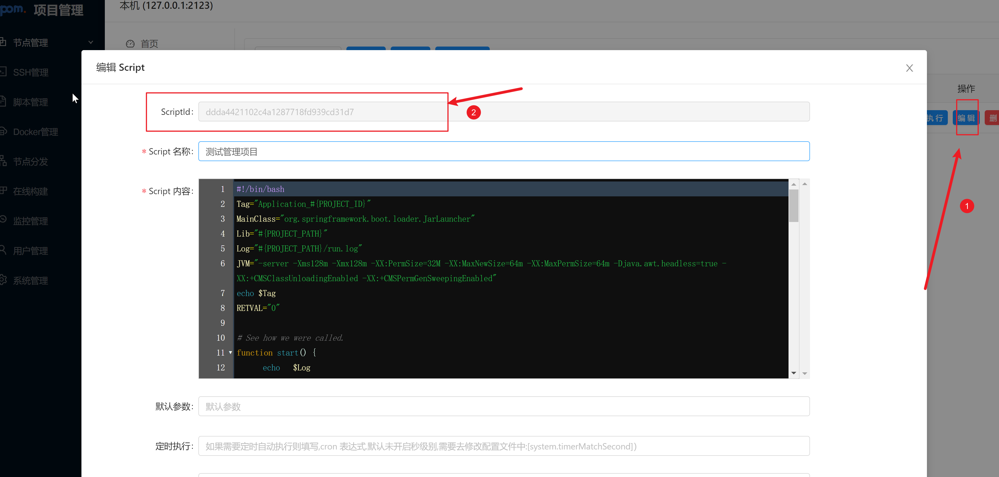

## 配置构建并发布到当前项目

::: tip 😋
案例就默认您已经会使用构建和项目发布了（不会的可以参考其他实践案例中的说明来操作）
:::

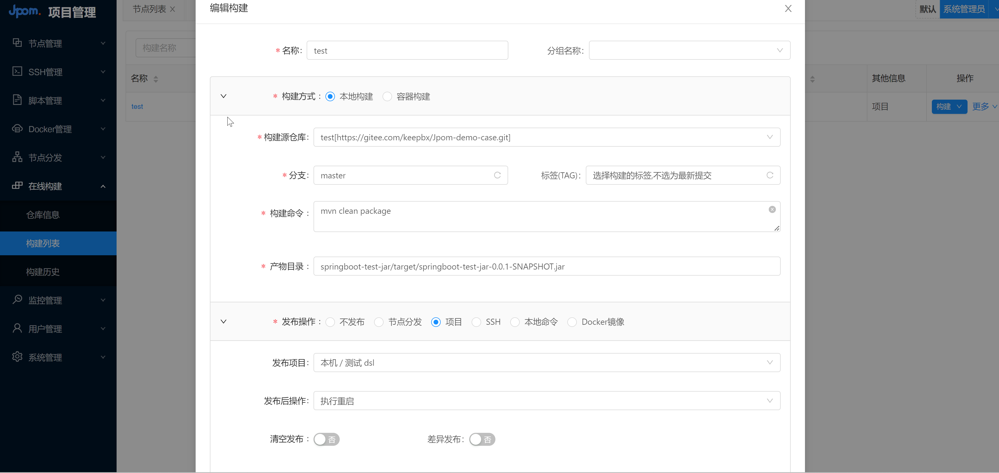

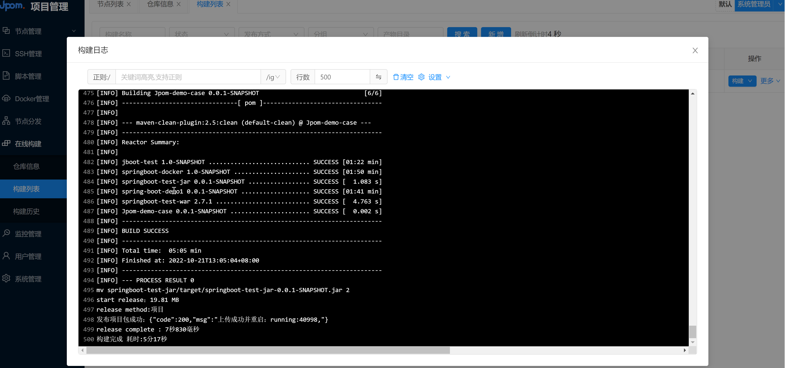

## 查看项目状态

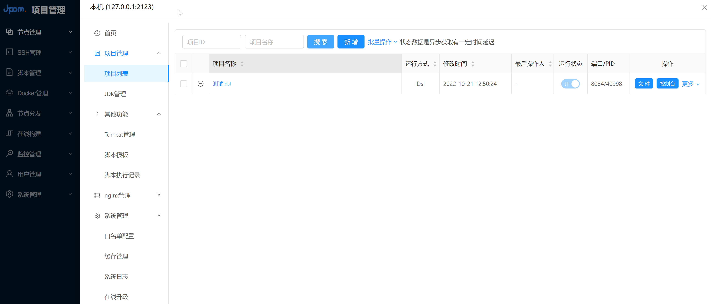

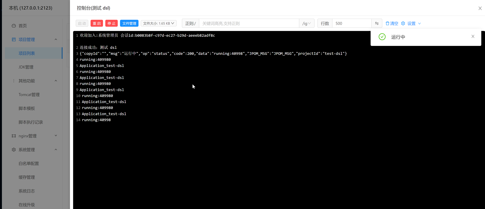

这样就实现使用接口来探活监控项目状态了


