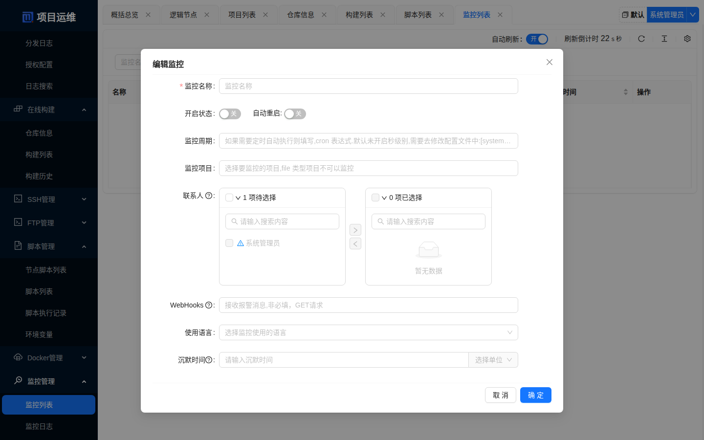

## 为什么需要「接口探活」

Jpom 判断普通项目是否运行，用的是**进程是否存在**（jps / 进程标识）。
进程还在、但接口已经不通（死锁、线程池打满、GC 卡死）这种「假死」，靠进程是发现不了的。

解决办法：把项目的 **status 流程换成「请求一个业务接口」**。
接口能正常返回 → 判定运行中；接口超时或返回异常 → 判定未运行 → 触发监控告警（可选自动重启）。

::: warning 探活只能用 Dsl 运行方式
只有 DSL 项目的 status 流程可以被自定义。Jar/War 运行方式的状态判断固定在 Jpom 内部，改不了。
所以「探活」这个场景必须把项目建成 **Dsl** 运行方式。
:::

## 整体思路

```text
监控列表（cron 周期）
   └── 轮询项目状态
          └── 调用 DSL 的 status 流程 → curl 业务接口
                 ├── 接口正常 → 输出 running:<PID> → 判定运行中
                 └── 接口异常 → 输出其它内容 → 判定未运行 → 报警 / 自动重启
```

## 一、准备探活接口

你的应用需要提供一个**轻量**的健康检查地址，例如：

- Spring Boot Actuator：`/actuator/health`
- 自定义：`/health`、`/ping`

要求：**不查库、不做重业务**，1 秒内能返回。否则会因为超时误判。

## 二、写节点脚本

【脚本管理】->【脚本列表】->【新增】，语言 shell，内容如下
（脚本 ID 保存后可在编辑弹窗里看到，下一步要用）：

```bash
#!/bin/bash
# 进程唯一标识：同机多实例也不会互相干扰
TAG="probe-app-${PROJECT_ID}"
LIB="${PROJECT_PATH}"
JAR="${LIB}/app.jar"
LOG="${LIB}/run.log"
# 按你的实际环境调整：JDK8 与 JDK11+ 都能用的通用参数
JVM="-server -Xms256m -Xmx256m -XX:MetaspaceSize=128m -XX:MaxMetaspaceSize=256m -Dfile.encoding=UTF-8"
# 探活地址：换成你自己的端口和路径
PROBE_URL="http://127.0.0.1:8084/health"

status_pid() {
  pgrep -f -- "-Dapp.tag=$TAG" | head -1
}

start() {
  local pid
  pid=$(status_pid)
  if [ -n "$pid" ]; then
    echo "already running: $pid"
    return
  fi
  [ -f "$JAR" ] || { echo "jar not found: $JAR"; exit 1; }
  nohup java $JVM -Dapp.tag="$TAG" -jar "$JAR" >> "$LOG" 2>&1 &
  sleep 3
  tail -n 10 "$LOG"
}

stop() {
  local pid
  pid=$(status_pid)
  if [ -z "$pid" ]; then
    echo "not running"
    return
  fi
  echo "stopping $pid"
  kill "$pid"
  for i in $(seq 1 10); do
    [ -z "$(status_pid)" ] && break
    sleep 1
  done
  pid=$(status_pid)
  [ -n "$pid" ] && kill -9 "$pid"
}

status() {
  local pid
  pid=$(status_pid)
  if [ -z "$pid" ]; then
    echo "stopped"          # 进程都没了
    return
  fi
  # -m 2：最多等 2 秒；--fail：HTTP >= 400 视为失败
  if curl -sf -m 2 -o /dev/null "$PROBE_URL"; then
    echo "running:$pid"     # 进程在 + 接口通 → 才算运行中
  else
    echo "probe failed: $PROBE_URL"   # 进程在但接口不通 → 判定未运行
  fi
}

case "$1" in
  start)   start  ;;
  stop)    stop   ;;
  restart) stop; start ;;
  status)  status ;;
  *) echo "usage: $0 {start|stop|restart|status}"; exit 1 ;;
esac
```

::: danger 三个必须注意的点
1. **status 的执行时间要短**：Jpom 是**串行**轮询所有项目状态的，单个 status 卡 5 秒会让整页状态刷新变慢。
   `curl` 一定要带 `-m`（例如 `-m 2`），不要用默认无限等待。
2. **最后一行必须是 `running:<PID>`** 才会被判为运行中；其它任何输出都算未运行。
3. **不要在 start 里无条件先 stop**：老教程里那种「启动前先杀一遍」在探活场景会造成
   「监控判定未运行 → 自动重启 → 重启又把正在恢复的进程杀掉」的抖动。用 `status_pid` 判断即可。
:::

## 三、创建 DSL 项目

【节点&项目】->【项目列表】->【+ 新增】-> 选节点 -> 运行方式选 **Dsl**：

```yaml
description: 带接口探活的 Java 应用
run:
  start:
    scriptId: 你的脚本ID
    scriptArgs: start
  status:
    scriptId: 你的脚本ID
    scriptArgs: status
  stop:
    scriptId: 你的脚本ID
    scriptArgs: stop
  execPath: ./
```

::: tip scriptId 填什么
- 填**节点脚本**的 scriptId（【脚本管理】->【节点脚本列表】里能看到），需要先把脚本下发到该节点
- 或者把脚本放进项目目录，`scriptId: project.sh`
- 或用脚本库脚本：`scriptId: G@脚本标记`

详见 [DSL 配置详解](/pages/dsl-config/)。
:::

## 四、先验证，再上监控

手动验证一遍，确保「接口挂了 → 状态变未运行」这条链路成立：

```bash
# 1) 正常情况：应输出 running:<pid>
bash project.sh status

# 2) 停掉业务进程（或临时把业务接口弄挂）
# 3) 再次执行：应输出 stopped 或 probe failed
bash project.sh status
```

同时到【节点&项目】->【项目列表】看该项目状态是否随之变化。

## 五、配置监控与告警

### 1. 配发件邮箱

【系统管理】->【配置管理】->【邮箱配置】，填 SMTP（注意密码用**授权码**不是登录密码）。

### 2. 新增监控

【监控管理】->【监控列表】->【新增】：



| 字段 | 建议值 |
| --- | --- |
| 监控名称 | 应用名-探活 |
| 开启状态 | 开 |
| 监控周期 | `0 */2 * * * ?`（每 2 分钟；秒级需服务端开 `jpom.system.timer-match-second`） |
| 监控项目 | 选择这个 DSL 项目（**File 类型项目不能监控**） |
| 通知人 | 选接收人 |
| WebHooks | 需要推到钉钉/企微时填 |
| 沉默时间 | 建议 ≥ 10 分钟，避免抖动刷屏 |

### 3. 要不要开自动重启

监控列表的【自动重启】会让 Jpom 在判定未运行时尝试启动项目。

::: warning 自动重启的两个前提
1. 你的 `start` 流程必须**幂等**（已经在跑时直接返回，不要重复拉起）
2. `status` 的判定要**足够稳**（探活接口不要因为一次慢查询就失败）

否则会出现「业务只是慢了一下 → 被判未运行 → 自动重启」的雪崩。
建议先只开告警，观察一周误报率后再开自动重启。
:::

## 六、常见问题

**Q：一直显示未运行，但接口用浏览器能打开**

A：多半是 `curl` 带了代理或 DNS 解析问题。脚本里对 `127.0.0.1` 探活建议加 `--noproxy '*' `：

```bash
curl -sf -m 2 --noproxy '*' -o /dev/null "$PROBE_URL"
```

**Q：状态在「运行中/未运行」之间反复跳**

A：① 探活接口本身慢（加缓存或换更轻的接口）；② `-m` 给得太小；③ 监控周期比接口恢复时间还短。

**Q：监控有记录但没收到邮件**

A：先确认【邮箱配置】能发测试邮件；再看监控的【通知人】是否选了人、【沉默时间】是否把后续通知吞掉了。

**Q：能不能不用 Dsl 也做探活**

A：不能。Jar/War 运行方式的 status 是内置的。替代方案是用【监控管理】的 WebHook 配合外部探测，但那已经不属于 Jpom 内部状态了。

## 相关文档

- [DSL 说明与典型场景](/pages/FQA/DSL/)
- [DSL 配置详解](/pages/dsl-config/)
- [DSL 常见问题与排查](/pages/9c85bc/)
- [监控与告警（图文）](/pages/monitor-guide/)
- [DSL 项目接口探活（2.9 版写法，仅供对照）](/pages/practice/ac7b66/)
