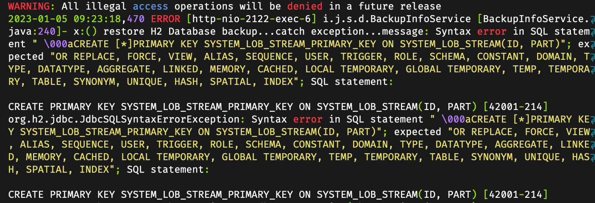

[[toc]]

## 前言

### 问：升级到 2.9.x 为什么要特殊处理？

**答** ：因为 H2 在 `1.4.198, 2.0.202` 版本间存在漏洞，漏洞编号为：`CVE-2021-23463`，所以需要尽快升级到最新版本来避免该漏洞。
但是 H2 的 1.4.x 升级到 2.0.x 是不兼容版本升级，不能直接无感升级。必须迁移旧数据到新版本中

---

### 问：该漏洞出现了一段时间，为什么现在才发修复版？

**答**：当我们看到漏洞相关消息就开始准备方案，我们刚开始想的方案是如何避免过多的人为操作，尽量自动化完成。
结果我们尝试发现没有办法很好的避免（准备出一个界面化的操作），最后采用命令行方式操作。（此处自动🐶）

## 升级流程总览

1. **需要先升级到 2.8.24+** [安装包下载地址](/pages/all-downloads/)
   1. 升级方法有：在线升级、手动上传 jar 包等方式升级
2. 检查 `Server.sh` 脚本中 `ARGS` 变量最后是否存在 `$@` 字符
   1. 如果不存在则需要手动添加
   2. `ARGS` 变量完整示例：`ARGS="--jpom.applicationTag=${Tag} --spring.profiles.active=pro --server.port=2122  --jpom.log=${Path}log $@"`
3. **为了数据安全避免升级出现异常造成数据丢失，请手动备份一下 `db` 目录**
   1. 备份前一定要先关闭服务器程序，否则会出现数据库异常情况或者数据丢失等异常
   2. 关闭方式：`bash /xxxx/Server.sh stop`
   3. 备份 db 目录方式：`cp -r /xxxx/jpom-server/db /xxxx/jpom-server/db_backup`
4. 通过命令行的方式创建数据备份
    1. 启动程序参数里面添加 --backup-h2
    2. linux 环境举例：`bash /xxxx/Server.sh restart -15 --backup-h2`
    3. 当控制台输出 `Complete the backup database, save the path as /xxx/xxx/db/backup/xxxx.sql` 字样表示备份成功
5. 手动替换 jar
   1. 将 lib 目录下面的 `Server-2.8.x.jar` 替换为最新的 `Server-2.9.x.jar`
   2. 注意可能需要修改 `Server.sh` 脚本里面的 `RUNJAR` 变量值为您上传新 jar 的文件名，如：`Server-2.9.x.jar`
6. 通过指定 sql 文件方式启动
   1. 启动程序参数里面添加 `--replace-import-h2-sql=/xxxx.sql --transform-sql` (路径需要替换为第二步控制台输出的 sql 文件保存路径)
   2. linux 环境举例：`bash /xxxx/Server.sh restart -15 --replace-import-h2-sql=/xxxx.sql --transform-sql`
7. 观察控制输出内容
   1. 当控制台输出 `Import successfully according to sql,/xxx/xxx/db/backup/xxxx.sql` 字样表示升级成功并自动启动程序
   2. 如果出现异常信息可以先尝试在搜索引擎搜索看看是否有解决办法
   3. 联系官方协助排查
8. **补充步骤：** `2.9.0` 版本操作完成后基本功能使用正常，但是 SSH 相关功能会出现数据库异常（缺少字段）
   1. 需要重新初始化数据：`bash /xxxx/Server.sh restart -15 --rest:load_init_db`
   2. 执行这个操作需要使用 2.9.1+ 版本（2.9.0 存在问题，此处自动🐶）
9. 愉快的使用 Jpom 2.9.x

## 相关问题说明

### 问：必须先升级到 2.8.24+？

**答**：非必须，因为 2.8.24+ 新增了命令行方式备份数据，这样在程序未启动前就将所有数据备份导出为 sql 保证导出的数据是最新并且完整的。
如果您不想升级到 2.8.24+ 再升级到 2.9.x 那么可以先用管理身份登录进入系统进入：【系统管理 -> 数据库备份】页面里面去创建一个全量备份记住备份文件完成路径

**注意**：`不通过命令行备份不能保证导出的备份数据一定是最新的奥，因为程序在运行中随时会产生新数据或者数据更新情况`


---- 

### 问：如何查看备份记录中的备份文件路径？

**答**：备份列表中状态列后面有一个复制按钮，点击一下就复制到粘贴板啦

---- 

### 问：执行 `bash /xxxx/Server.sh restart -15 --backup-h2` 不生效该怎么办？

**答**：如果您是从很早就使用了 Jpom 那么您现在管理服务端当脚本不是最新当，最新的管理脚本里面将执行命令的其他参数也传入了启动程序里面

解决办法有：

1. 替换为最新的管理脚本文件 [Server.sh](https://gitee.com/dromara/Jpom/blob/master/modules/server/src/main/bin/Server.sh)
2. 手动修改管理脚本，在脚本中 `ARGS` 变量最后添加一个 `$@` 即可
   1. 完整示例：`ARGS="--jpom.applicationTag=${Tag} --spring.profiles.active=pro --server.port=2122  --jpom.log=${Path}log $@"`

----

### 问：官方是不是忘记还用 windows 用户啦？

**答**：没有的，因为 linux 用户偏多，所以拿 linux 举例。windows 处理办法类似

可以按照 [Server.bat](https://gitee.com/dromara/Jpom/blob/master/modules/server/src/main/bin/Server.bat) 中 if 判断继续扩展

```shell
set /p ID=
IF "!ID!"=="1" call:start
IF "!ID!"=="2" call:stop
IF "!ID!"=="3" call:status
IF "!ID!"=="4" call:restart
IF "!ID!"=="5" call:use
IF "!ID!"=="6" call:restart --rest:ip_config
IF "!ID!"=="7" call:restart --rest:load_init_db
IF "!ID!"=="8" call:restart --rest:super_user_pwd
IF "!ID!"=="0" EXIT
```

思路添加 IF,比如：

```shell
set /p ID=
IF "!ID!"=="1" call:start
IF "!ID!"=="2" call:stop
IF "!ID!"=="3" call:status
IF "!ID!"=="4" call:restart
IF "!ID!"=="5" call:use
IF "!ID!"=="6" call:restart --rest:ip_config
IF "!ID!"=="7" call:restart --rest:load_init_db
IF "!ID!"=="8" call:restart --rest:super_user_pwd
IF "!ID!"=="9" call:restart --backup-h2
IF "!ID!"=="10" call:restart --replace-import-h2-sql=/xxxx.sql --transform-sql
IF "!ID!"=="0" EXIT
```

`注意要修改 sql 路径`

----

### 问：不想通过管理脚本来操作，还有其他方法吗？

**答**：有

1. 备份数据

```shell
java -jar server-2.8.24.jar --spring.profiles.active=pro --backup-h2
```
2. 导入数据

```shell
java -jar server-2.9.0.jar --spring.profiles.active=pro --replace-import-h2-sql=/xxxx.sql --transform-sql
```

3. 更新管理脚本中的：`RUNJAR` 变量值为：`server-2.9.0.jar`

**注意**：

1. 通过次方式一定要在原目录操作
2. 操作顺序一定是要先使用旧包备份数据，再通过新包导入数据

----

### 问：容器安装的应该如何升级？

**答**：升级流程和 Linux 流程基本一致，需要注意的就是上传文件的方式需要先上传到宿主机，再通过 `docker cp` 方式将文件复制到容器中。

下面以从 2.8.24 升级到 2.9.0 为例：

```shell
# 注意：从 2.8.24 版本开始新增数据库备份的参数命令，建议先升级到 2.8.24
# 备份低版本数据库
docker exec -it jpom-server /bin/bash /usr/local/jpom-server/Server.sh restart -15 --backup-h2
# 执行完后看到【Need to log out manually: Ctrl+C/Control+C】用 Ctrl + C 手动退出

# 替换脚本命令中为新版 Jar 包
docker exec -it jpom-server sed -r -e '/^RUNJAR="/s@.*@RUNJAR="Server-2.9.0.jar"@g' /usr/local/jpom-server/Server.sh -i

# docker cp 本地文件路径 容器ID/容器NAME:容器内路径
docker cp /root/Server-2.9.0.jar jpom-server:/usr/local/jpom-server/lib/Server-2.9.0.jar

# 进入容器内部
docker exec -it jpom-server /bin/bash
# 将低版本的数据库导入到新版本中
backupFile=`ls -t /usr/local/jpom-server/data/db/backup/ | head -1`
/bin/bash /usr/local/jpom-server/Server.sh restart -15 --replace-import-h2-sql=/usr/local/jpom-server/data/db/backup/$backupFile --transform-sql
# 启动完成后，输入 Ctrl + C 退出。
# 退出容器，回到宿主机
exit
```

### 问：升级服务端后需要将插件端也升级到 2.9.0+ 吗？

**答**：我们建议服务端和插件端的版本一致，可以同步升级到 2.9.0。

只要您在使用过程中没有发现部分功能异常，无法使用，接口 404 等情况下，插件端不及时更新也是没有太多问题的。

插件端和服务端版本差异请尽量一致或者缩小，避免出现部分功能调整后关联影响。

### 问：哪里下载 2.8.24+ 安装包？

**答**：[下载中心](/pages/all-downloads/)

### 问：插件端该如何升级到 2.9.0+ ?

**答**：插件端还是可以使用以前的方式：手动上传 jar，在线升级等。推荐使用在线升级，可以在服务端页面批量升级插件端版本

### 问：新版本导入 sql 报错，怎么办呀！！！！

**答**： 如果出现如下错误


可以检查执行的命令测试是否包含了：`--transform-sql` 或者 `--transform-sql=true`

如果包含了还是不能解决，您可以手动修改对应的 sql 文件

将

```sql
CREATE PRIMARY KEY SYSTEM_LOB_STREAM_PRIMARY_KEY ON SYSTEM_LOB_STREAM(ID, PART);
```

这一行删除即可