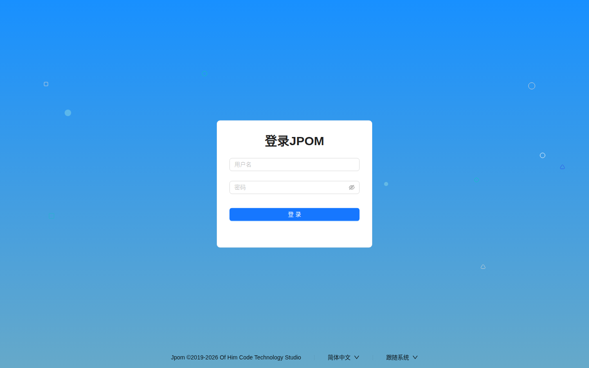
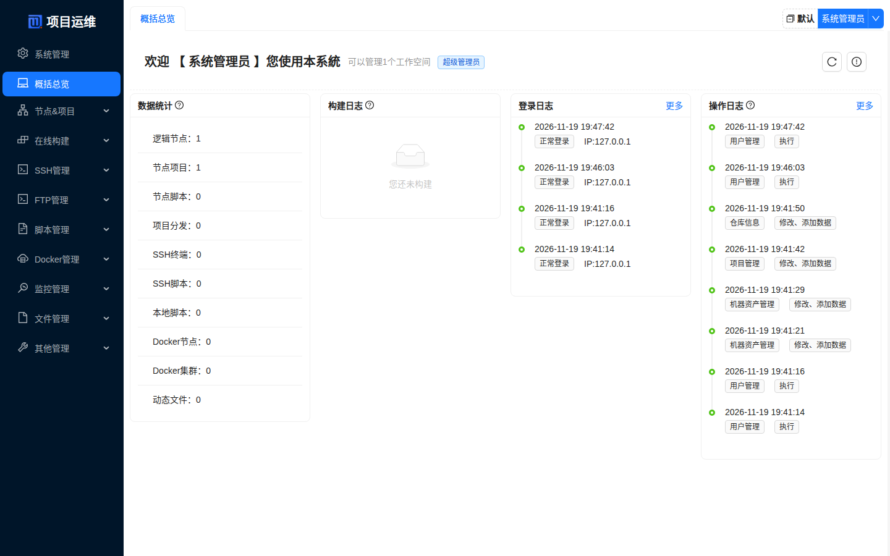
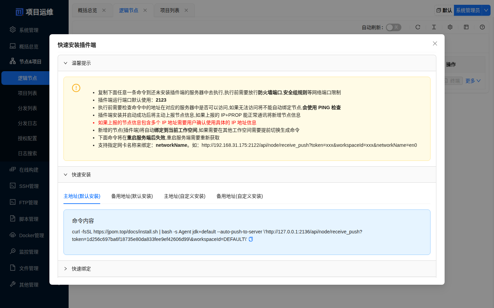
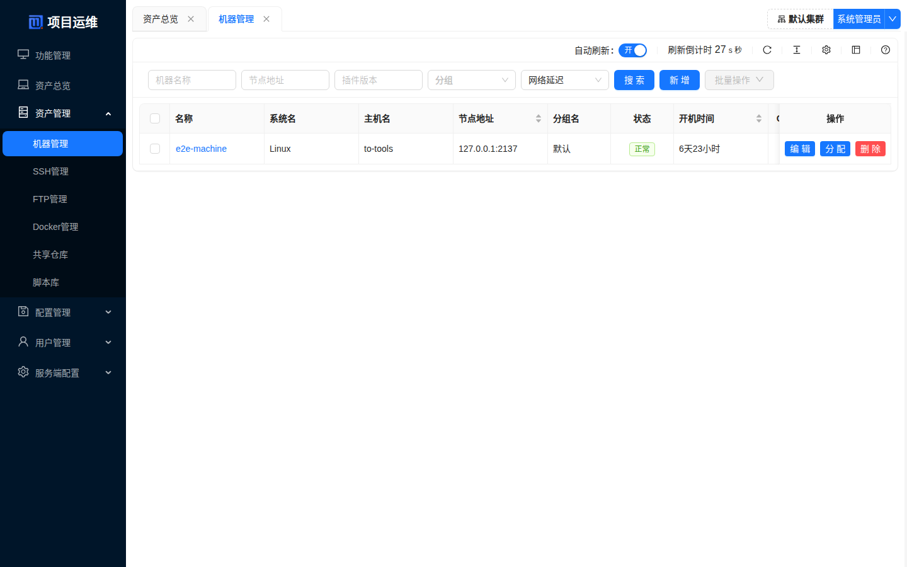
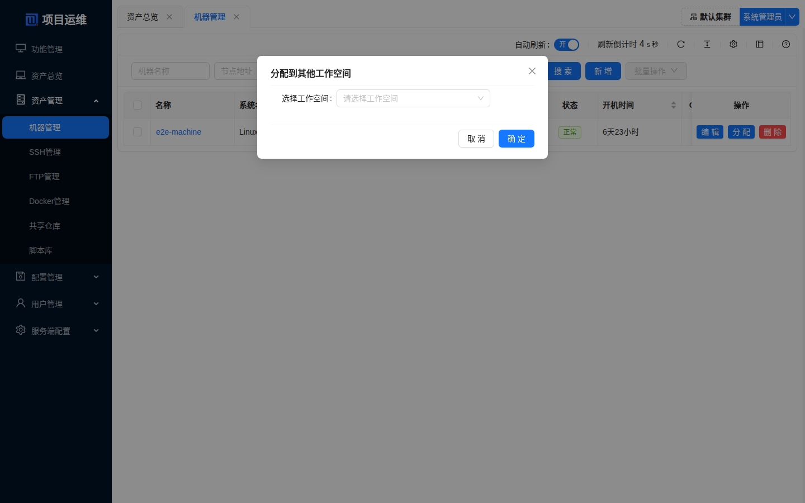
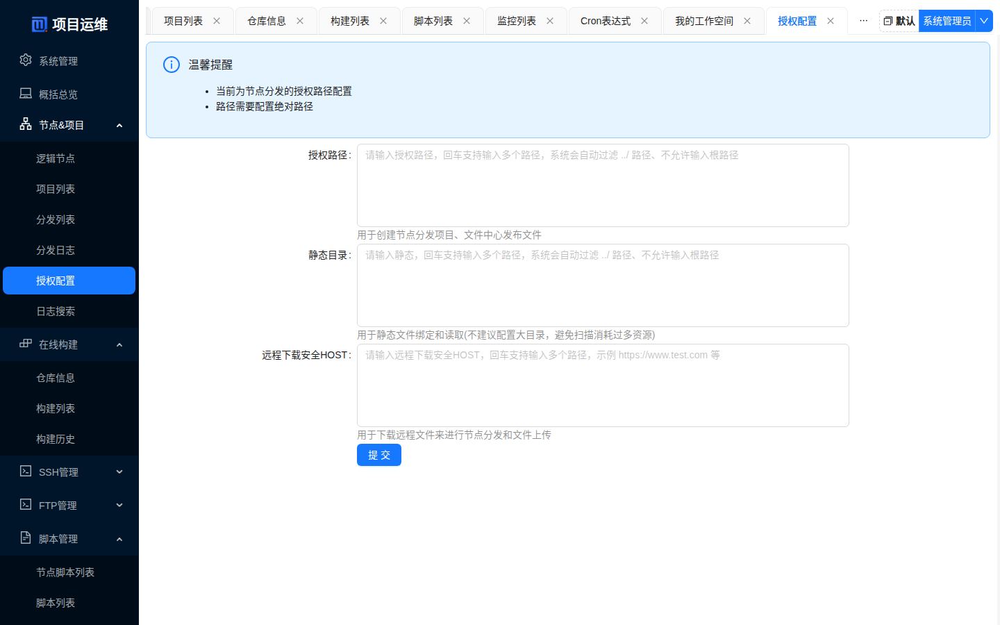
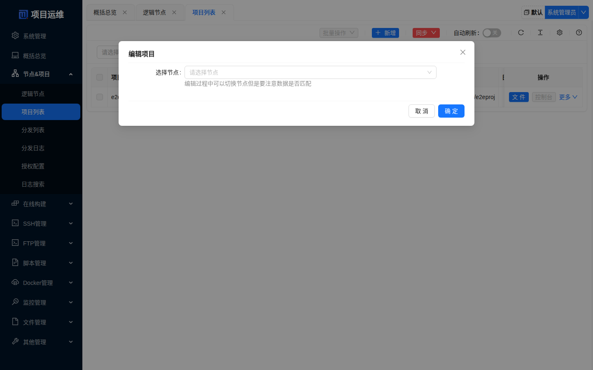
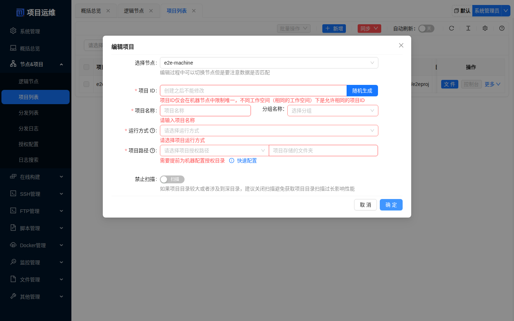
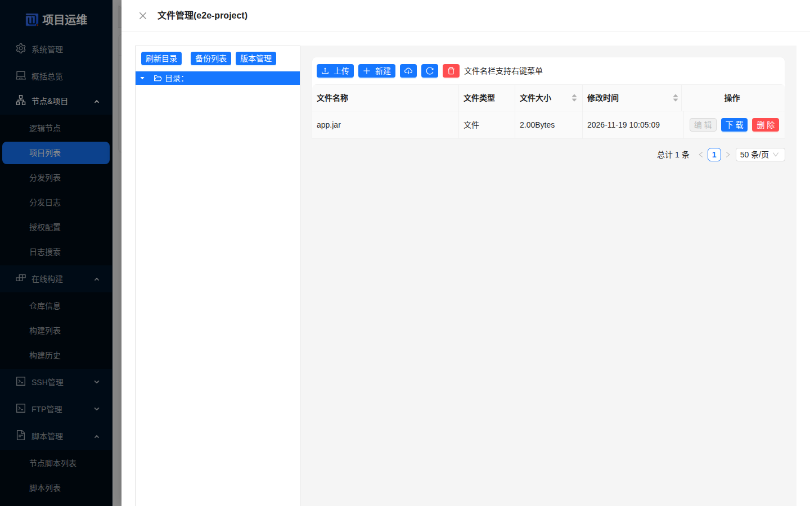

## 写在前面

这篇文档假设您**已经装好并启动了 Jpom 服务端**（没装请先看[一键安装](/pages/fe28e9/)或[下载安装](/pages/db3065/)）。
接下来的 6 步，每步都给出：要点的按钮、在哪个菜单、做完怎么确认成功。

::: tip 只用记住一句话
Jpom 的关系是：**工作空间 → 机器（插件端）→ 逻辑节点 → 项目/脚本**。
所有操作都围绕这条链路展开，哪一步断了，后面的按钮就会是灰的或点不动。
:::

## 第 1 步：登录

浏览器打开 `http://服务端IP:2122`（**服务端默认端口 2122**，插件端是 2123 且不提供网页界面）。

首次安装会引导您创建**超级管理员**账号。建议：
- 不要用 `admin`、`root` 这类常见名（避免被撞库导致账号被锁）
- 密码用密码管理器生成，并**立即开启 MFA 两步验证**

✅ 验收：登录后能看到「概括总览」页面。

## 第 2 步：认识三个界面

Jpom 有两个「世界」，**左侧菜单最上面一项就是切换开关**：

| 界面 | 长什么样 | 用来做什么 | 谁能进 |
| --- | --- | --- | --- |
| 项目运维（工作空间） | 菜单第一项写着【系统管理】 | 日常干活：项目、脚本、构建、监控、SSH | 所有有工作空间权限的用户 |
| 系统管理（管理中心） | 菜单第一项写着【功能管理】 | 管资产和系统：机器、用户、权限组、系统配置 | 仅系统管理员 |

右上角有**工作空间切换**（截图里的「默认」）和**当前账号**（点旁边的 ▾ 有修改密码、MFA、退出登录）。
菜单全貌见[菜单地图](/pages/menu-map/)。

## 第 3 步：把一台服务器接进来（添加机器）

有两种方式，任选一种：

### 方式 A：快速安装（推荐，机器上什么都还没装）

【节点&项目】->【逻辑节点】-> 右上角【快速安装】，复制弹窗里的命令到目标服务器执行：

::: warning 执行前检查
- 目标服务器能访问服务端端口（默认 2122），防火墙/安全组要放行
- 插件端端口默认 2123，**服务端要能反向访问插件端的 2123**
- 安装成功后会自动上报机器并绑定到当前工作空间，弹窗里会轮询显示【执行结果】
- 命令在服务端重启后失效，需要重新获取
:::

### 方式 B：手动添加（插件端已经装好了）

【系统管理】->【资产管理】->【机器管理】->【新增】，填机器名称、节点地址（`IP:2123`）、节点账号/密码：

::: tip 节点账号密码从哪来
插件端**首次启动**时会在控制台输出节点账号（默认 `jpomAgent`）和密码，密码是随机生成的。
如果没记下来，去插件端数据目录的 `agent_authorize.json` 里找，或直接重置插件端授权。
:::

✅ 验收：【机器管理】里该机器状态是**正常**（能出 CPU、内存、开机时间，说明双向连通）。

## 第 4 步：把机器分配给工作空间（变成逻辑节点）

机器是「资产」，工作空间只认「逻辑节点」。所以在【机器管理】该行点【分配】，选择目标工作空间：

然后回到【节点&项目】->【逻辑节点】，就能看到这台机器，状态显示**正常**（下图为逻辑节点页面，弹窗即上一步的快速安装）：

✅ 验收：逻辑节点列表出现该机器，点【管理】能看到「项目 / 脚本 / 日志」页签。

## 第 5 步：配一个授权目录（项目放哪）

【节点&项目】->【授权配置】，把存放项目的**绝对路径**填进【授权路径】，回车可加多个，然后提交：

::: danger 为什么必须先配
Jpom 只允许在授权目录下创建/删除项目文件，这是安全边界。
没配就会出现「项目路径下拉是空的」、或者新增项目失败。
:::

## 第 6 步：新增项目并启动

【节点&项目】->【项目列表】->【+ 新增】：

1. 先**选择节点**（弹窗标题是「编辑项目」）：
2. 再填项目信息：项目 ID（可随机生成，创建后不能改）、项目名称、**运行方式**、项目路径：
3. 保存后进入项目详情，按需补 JVM 参数、args、自启动等
4. 回到列表，在【操作】列点【控制台】或【更多】里的启动

✅ 验收：项目状态变为**运行中**，能看到端口号和进程号；【控制台】里有实时输出。

## 卡住了？按这张表排查

| 现象 | 原因 | 怎么办 |
| --- | --- | --- |
| 机器状态「无法连接」 | 服务端访问不到插件端 2123 | 查防火墙、安全组、插件端是否在跑 |
| 机器状态「授权信息错误」 | 节点账号或密码不对 | 重置插件端授权后重新填 |
| 逻辑节点列表是空的 | 机器没分配给当前工作空间 | 【机器管理】->【分配】 |
| 项目路径下拉为空 | 没配授权目录 | 【授权配置】里加绝对路径 |
| 项目点了启动没反应 | 运行方式/启动命令不对 | 看【控制台】输出；File 类型没有启动功能 |
| 所有按钮都是灰的 | 当前账号没有该工作空间的权限 | 找管理员在【系统管理】->【用户管理】->【权限组】里授权 |

## 接下来可以做什么

- 想让它**自动构建部署**：看[在线构建：从仓库到发布](/pages/build-guide/)
- 想跑**定时任务/备份**：看[节点脚本](/pages/8a95bf/)
- 想让**多个节点同时跑同一个项目**：看[节点分发](/pages/e35370/)
- 想**出错就告警**：看[监控与告警](/pages/monitor-guide/)
