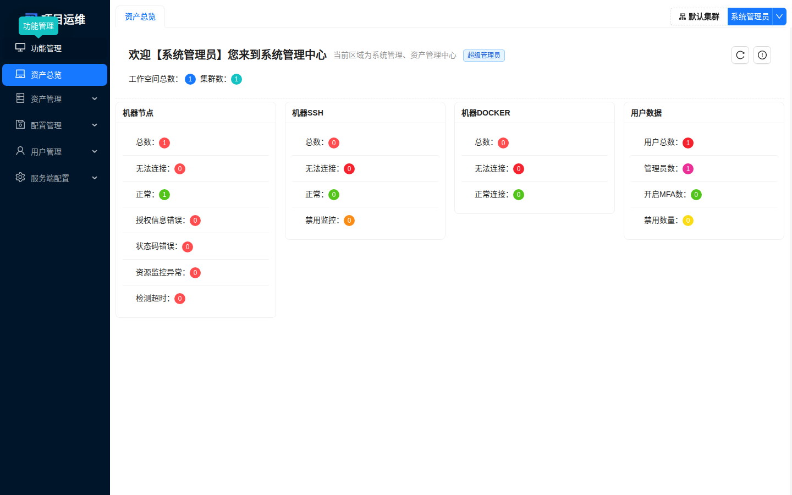
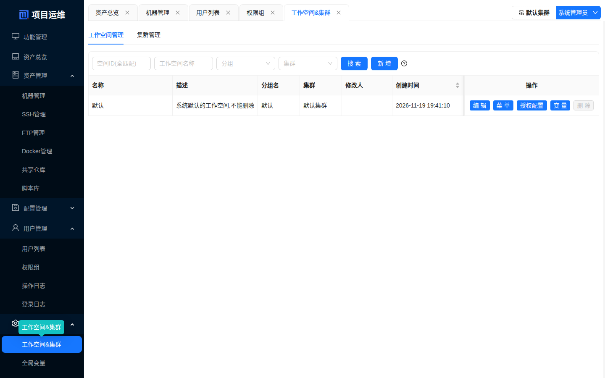

## 为什么要看这篇

Jpom 的菜单在 2.11 版本做过一次大调整：**业务操作**和**系统管理**被拆成两套菜单，
网上很多老教程还在写「系统管理 → 节点管理 → 系统配置」这类已经不存在的老路径。
这篇按 **2.11.x 实际界面**整理，照抄即可。

::: tip 一句话定位入口
左侧菜单**最上面那一条**就是切换开关：
- 在业务界面时，它写着【系统管理】——点它进入系统管理
- 在系统管理时，它写着【功能管理】——点它回到业务界面

它不是右上角，也不是头像下拉。
:::

## 一、业务界面（项目运维）

| 一级菜单 | 二级菜单 | 能做什么 | 备注 |
| --- | --- | --- | --- |
| 概括总览 | — | 数据统计、构建日志、登录/操作日志 | 默认首页 |
| 节点&项目 | 逻辑节点 | 看已分配到本工作空间的机器，进入节点管理 | |
| | 项目列表 | 新增/启动/停止/删除项目，看文件和控制台 | 最常用 |
| | 分发列表 | 一个项目发布到多个节点 | |
| | 分发日志 | 每次分发的执行结果 | |
| | 授权配置 | 配项目/分发的授权目录、静态目录、远程下载 HOST | ⚠️ 仅系统管理员 |
| | 日志搜索 | 跨节点检索日志文件 | |
| 在线构建 | 仓库信息 | 管理 Git 仓库凭据 | |
| 流水线 | 流水线列表 | 多仓库多阶段编排：构建/命令/发布/审批/通知，一次运行按顺序执行 | 与在线构建并存，独立权限点与数据 |
| | 构建列表 | 新增构建（5 步向导）、手动构建 | |
| | 构建历史 | 每次构建的日志、产物、状态 | |
| SSH管理 | SSH列表 | 网页终端、文件上传下载 | |
| | 命令管理 | 常用命令模板 | |
| | 命令执行记录 | 谁在什么时候执行了什么 | |
| FTP管理 | FTP列表 | FTP 资产与文件浏览 | |
| 脚本管理 | 节点脚本列表 | 已下发到节点的脚本 | |
| | 脚本列表 | 脚本模板（可定时） | |
| | 脚本执行记录 | 执行历史与输出 | |
| | 环境变量 | 工作空间级变量 | |
| Docker管理 | Docker列表 | 容器/镜像管理 | |
| | 集群列表 | Swarm 集群 | |
| 监控管理 | 监控列表 | 项目状态/接口探活监控 | |
| | 监控日志 | 监控触发记录 | |
| | 操作监控 | 项目操作审计 | |
| 文件管理 | 文件列表 | 文件中心（上传/分发/发布） | |
| | 静态文件 | 静态文件绑定与访问 | |
| | 发布任务 | 文件发布任务 | |
| 其他管理 | 证书管理 | SSL 证书托管 | |
| | 我的工作空间 | 我加入的工作空间 | |
| | 网络工具 | 端口/连通性排查工具 | ⚠️ 仅系统管理员 |
| | Cron表达式 | Cron 生成与解释 | |

## 二、系统管理界面（管理中心）

| 一级菜单 | 二级菜单 | 能做什么 | 备注 |
| --- | --- | --- | --- |
| 资产总览 | — | 机器/SSH/Docker/用户 统计与异常数 | |
| 资产管理 | 机器管理 | 新增/编辑/分配机器，看资源与缓存监控 | 节点来源 |
| | SSH管理 | SSH 资产 | |
| | FTP管理 | FTP 资产 | |
| | Docker管理 | Docker 资产 | |
| | 共享仓库 | 全局 Git 仓库 | |
| | 脚本库 | 全局脚本模板 | |
| 配置管理 | 认证管理 | OAuth2 第三方登录配置 | |
| | 邮箱配置 | SMTP 发件配置（告警用） | |
| | 系统配置目录 | 在线编辑服务端 `conf/` 下的文件 | |
| 用户管理 | 用户列表 | 新增用户、重置密码、解锁、关 MFA | |
| | 权限组 | 工作空间 + 功能权限的组合 | 授权核心 |
| | 操作日志 | 全站操作审计 | |
| | 登录日志 | 登录/失败记录 | |
| 服务端配置 | 工作空间&集群 | 工作空间管理、集群管理、**菜单配置** | ⚠️ 菜单配置在这里 |
| | 全局变量 | 服务端级变量 | |
| | 缓存管理 | 清理缓存、看定时任务开关 | |
| | 系统日志 | 服务端运行日志 | |
| | 在线升级 | 服务端/插件端在线升级 | |
| | 系统配置 | 服务端系统配置、IP 授权配置、全局代理 | |
| | 数据库备份 | 数据库备份与恢复 | ⚠️ **仅 H2 模式可见** |
| | 关于系统 | 版本信息 | |

## 三、「我要做 X，去哪个菜单」速查

| 我要做的事 | 操作路径 |
| --- | --- |
| 加一台服务器 | 【节点&项目】->【逻辑节点】->【快速安装】，或【系统管理】->【资产管理】->【机器管理】->【新增】 |
| 让某个工作空间能用这台机器 | 【系统管理】->【资产管理】->【机器管理】-> 行内【分配】 |
| 新建一个项目 | 【节点&项目】->【项目列表】->【+ 新增】 |
| 上传 jar / 换包 | 【节点&项目】->【项目列表】-> 行内【文件】 |
| 看实时输出 | 【节点&项目】->【项目列表】-> 行内【控制台】 |
| 改 JVM 参数 | 项目详情 ->【JVM 参数】-> 保存 -> 重启项目 |
| 配定时任务 | 【脚本管理】->【脚本列表】->【新增】-> 填【定时执行】cron |
| 从 Git 自动构建部署 | 【在线构建】->【仓库信息】先加仓库 ->【构建列表】->【新增】-> 5 步向导 |
| 多仓库/多步骤/多目标发布 | 【流水线】->【流水线列表】->【新增】：加多个仓库源 -> 编排阶段（构建/命令/发布/审批/通知）->【运行】 |
| 配告警邮件 | 【系统管理】->【配置管理】->【邮箱配置】 |
| 项目挂了自动告警 | 【监控管理】->【监控列表】->【新增】-> 填【WebHooks】/选择通知人 |
| 给新同事开账号 | 【系统管理】->【用户管理】->【用户列表】->【新增】，再配【权限组】 |
| 隐藏某些菜单 | 【系统管理】->【服务端配置】->【工作空间&集群】-> 工作空间行内【菜单】 |
| 备份 / 恢复数据 | 【系统管理】->【服务端配置】->【数据库备份】（仅 H2 模式） |
| 改服务端端口 | 服务端 `conf/application.yml` 的 `server.port`，重启生效 |
| 改服务端配置 | 【系统管理】->【服务端配置】->【系统配置】 |
| 看谁动了什么 | 【系统管理】->【用户管理】->【操作日志】 |

## 四、最容易踩的 6 个「路径坑」

1. **没有「系统管理 → 服务端管理」这个菜单**，正确是【系统管理】->【服务端配置】
2. **数据库备份只在 H2 模式出现**，切到 MySQL/PostgreSQL 后该菜单会消失（备份要自己做）
3. **「节点管理」「资产机器」「分发授权配置」「插件端配置」都是老名字**，现名分别是：逻辑节点 / 机器管理 / 授权配置 / 机器管理里的【系统配置】
4. **菜单配置不在「系统配置」里**，而在【服务端配置】->【工作空间&集群】-> 工作空间行内【菜单】
5. **项目日志的备份策略不在服务端配**，属于**插件端** `conf/application.yml` 的 `jpom.project.log.*`
6. **普通用户看不到「授权配置」「网络工具」**，它们只对系统管理员显示

## 五、相关文档

- [十分钟上手](/pages/quickstart/)
- [节点项目](/pages/b3e508/)
- [权限说明](/pages/permissions/ca90a5/)
