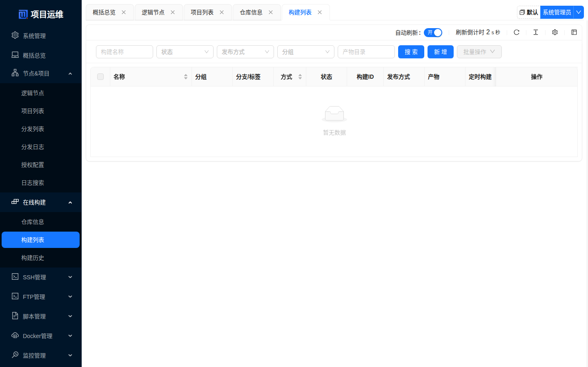
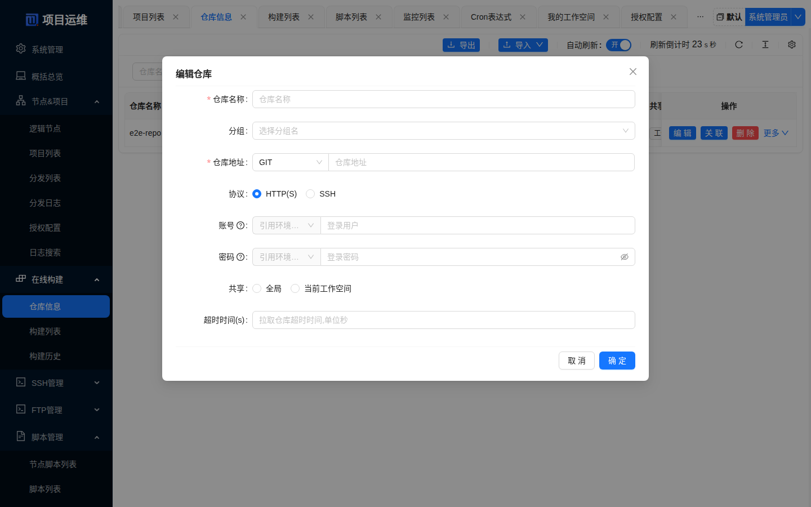
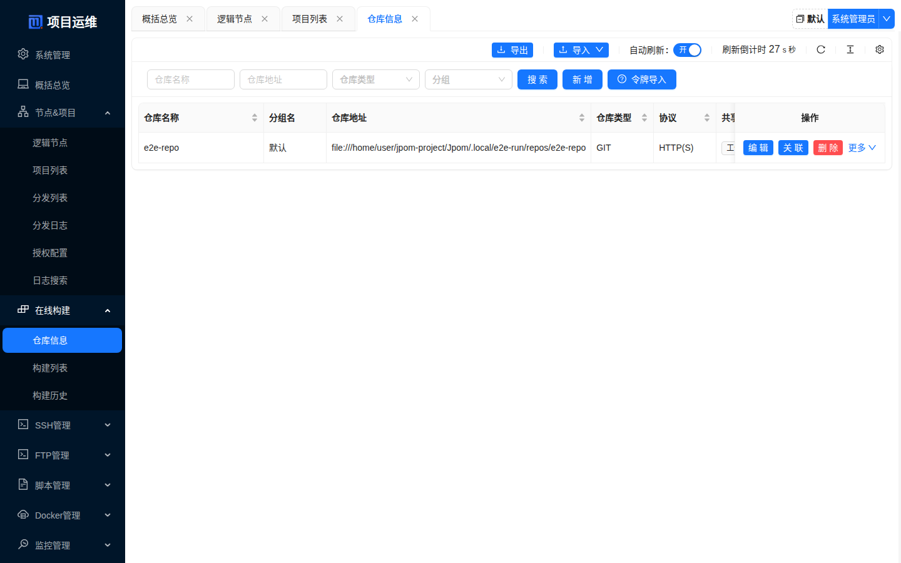
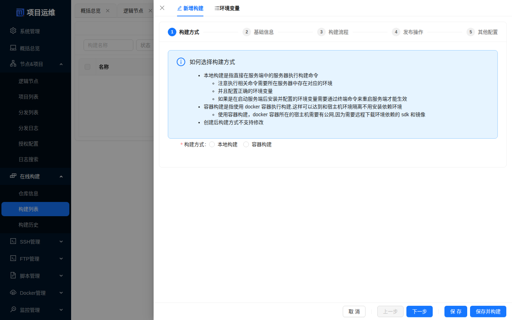
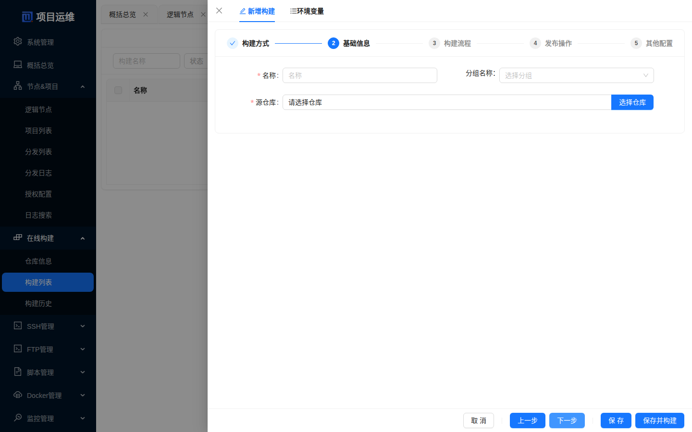

## 这个页面能帮你做什么

把「拉代码 → 编译打包 → 传到服务器 → 重启项目」这条链路交给 Jpom：
以后要么点一下按钮构建，要么推一次代码（Gitee/GitLab Webhook）就自动上线。

## 操作路径

| 步骤 | 菜单 |
| --- | --- |
| 1. 加仓库（只需一次） | 【在线构建】->【仓库信息】->【新增】 |
| 2. 建构建任务 | 【在线构建】->【构建列表】->【新增】 |
| 3. 看结果 | 【在线构建】->【构建历史】 |

## 第一步：加仓库

【仓库信息】->【新增】：

| 字段 | 说明 |
| --- | --- |
| 仓库名称 | 显示用 |
| 分组 | 虚拟分组 |
| 仓库类型 | 目前主要是 GIT |
| 仓库地址 | HTTPS 或 SSH 地址 |
| 协议 | 选 **HTTP(S)** 就填账号密码/令牌；选 **SSH** 需要提前在服务器上配好私钥 |
| 账号 / 密码 | 私有仓库必填；公开仓库可留空 |
| 引用环境变量 | 账号密码也可以从【脚本管理】->【环境变量】里引用，避免明文 |
| 全局 / 当前工作空间 | 全局仓库所有工作空间可用 |

## 第二步：新增构建（5 步向导）

【构建列表】->【新增】，会打开一个**整页向导**（不是弹窗），分 5 步：

### ① 构建方式

- **本地构建**：直接在服务端所在服务器执行构建命令 → 该服务器必须装好 JDK / Maven / Node 等
- **容器构建**：用 Docker 容器跑构建，环境隔离，不用在宿主机装依赖 → 需要先在【Docker管理】里添加 Docker 并分配工作空间，且宿主机能访问公网拉镜像

::: danger 选定后不能改
「创建后构建方式不支持修改」。如果两个都要，就建两个构建任务。
另外：**容器方式安装的 Jpom 服务端不能用本地构建**（容器里没有宿主机的构建环境）。
:::

### ② 基础信息

名称、分组名称、**源仓库**（点【选择仓库】挑上一步加的仓库）。

### ③ 构建流程

| 字段 | 说明 |
| --- | --- |
| 分支 | 必选，支持通配符（`feature/*`） |
| 标签 | 一般不选，默认拉最新提交 |
| 克隆深度 | 大仓库建议填 1，只拉最近一次提交 |
| 构建命令 | 如 `mvn clean package -Dmaven.test.skip=true`、`npm i && npm run build`，多行默认**逐行执行**，可用【严格执行】要求每一步退出码必须为 0 |
| 产物目录 | 相对仓库根目录，如 `target/app.jar`、`dist`，**只取匹配到的第一项** |
| 执行方式 | 默认 / 多线程（实验属性） |

构建命令里可用变量：`${BUILD_ID}`、`${BUILD_NAME}`、`${BUILD_NUMBER_ID}`，也可以引用工作空间变量和全局脚本库（`G@脚本名`）。

### ④ 发布操作

这是最容易配错的一步。先选**发布方式**：

| 发布方式 | 适用 |
| --- | --- |
| 不发布 | 只想编译验证，产物留在构建历史里 |
| **分发项目** | 多节点统一发布（需先有[节点分发](/pages/e35370/)） |
| **项目** | 发布到某个节点里的某个项目（最常用） |
| SSH | 通过 SSH 授权目录上传 + 执行命令 |
| 本地命令 | 在服务端本机执行命令发布 |
| Docker 镜像 / 集群 | 构建镜像、推到仓库、发布到 Swarm |

选「项目」时常见字段：

- **发布项目**：选节点 + 项目
- **发布后操作**：如重启项目
- **二级目录**：不填就发布到项目根目录
- **清空发布 / 差异发布**：清空=先删后传；差异=只传变化文件（两个都开时，会顺带删掉产物里没有的旧文件）
- **发布前停止**：先关项目再替换文件（Windows 下文件被占用时必须开）

::: tip 变量替换
发布前后命令支持 `${BUILD_ID}`、`${BUILD_NAME}`、`${BUILD_RESULT_FILE}`、`${BUILD_NUMBER_ID}`，
常见写法：发布前 `sh stop.sh`，发布后 `sh start.sh`。
:::

### ⑤ 其他配置

缓存构建、保留产物、差异构建、严格执行、**定时构建（cron）**、事件脚本、附加环境变量（.env）、
同步到文件管理中心、发布隐藏文件、保留天数/个数、版本快照、排除发布（ANT 表达式）。

配好后点【保存】或【保存并构建】。

## 第三步：触发构建

有三种方式：

1. **手动**：构建列表行内点【构建】
2. **定时**：在第 ⑤ 步填 cron（默认不支持秒级，需服务端开启 `jpom.system.timer-match-second`）
3. **代码推送自动构建**：
   - Gitee：详见[Gitee 提交代码后自动构建](/pages/practice/gitee-webhook-trigger-build/)
   - GitLab：详见[GitLab 提交代码后自动构建](/pages/practice/gitlab-webhook-trigger-build/)

构建完成后到【构建历史】看日志和产物；失败的构建会保留日志方便对照。

## 常见问题

**Q：构建报「mvn: command not found」？**
A：本地构建用的是**服务端所在服务器**的环境。装好 Maven/JDK 后，**重启服务端**才会读到新的环境变量。

**Q：产物找不到 / 发布后目录是空的？**
A：检查【产物目录】是否相对仓库根目录正确，且能匹配到实际文件（只取第一个匹配项）。

**Q：发布到项目失败，提示没有授权目录？**
A：发布目标需要授权目录：项目用【节点&项目】->【授权配置】；SSH/FTP 发布需要各自配置授权目录。

**Q：想回到上一个版本？**
A：开启【版本快照】后可在项目文件页的【版本管理】里回滚；或在【构建历史】里重新发布历史产物。

## 相关文档

- [节点项目](/pages/b3e508/)：发布目标项目怎么建
- [节点分发](/pages/e35370/)：多节点统一发布
- [构建相关常见问题](/pages/FQA/6a1f29/)
