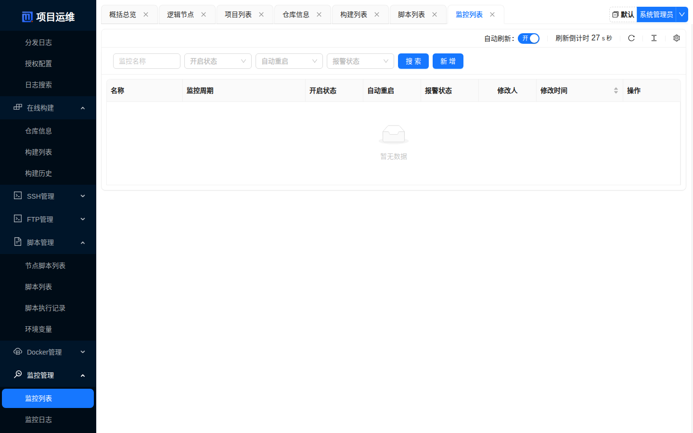
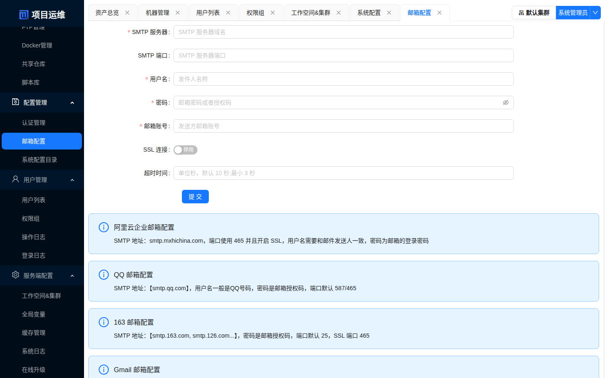
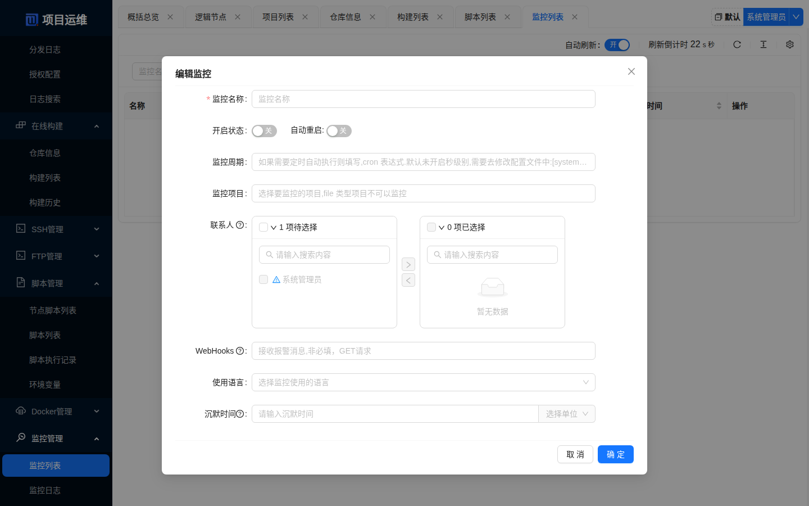

## 这个页面能帮你做什么

配好监控后，项目异常停止、接口探活失败时 Jpom 会：
1. 记录一条**监控日志**
2. 按配置**发邮件 / 调 WebHook** 通知到人
3. 可选**自动重启**项目，先把服务拉起来再排查

## 操作路径

| 想做的事 | 真实路径 |
| --- | --- |
| 新增/管理监控 | 【监控管理】->【监控列表】 |
| 看触发记录 | 【监控管理】->【监控日志】 |
| 看项目操作审计 | 【监控管理】->【操作监控】 |
| 配发件邮箱（告警必要前提） | 【系统管理】->【配置管理】->【邮箱配置】 |

列表关键列：**监控周期、开启状态、自动重启、报警状态**。

## 第一步：先配好发件邮箱

想收邮件告警，必须先配 SMTP，否则监控触发了也发不出邮件。

| 字段 | 说明 |
| --- | --- |
| SMTP 服务器 / 端口 | 如 `smtp.qq.com:465`（SSL） |
| 用户名 | 发件人名称 |
| 密码 | 邮箱的**授权码**，不是登录密码 |
| 邮箱账号 | 实际发信账号 |
| SSL 连接 | 465 端口一般要开 |
| 超时时间 | 默认 10 秒，最小 3 秒 |

页面下方有阿里云企业邮、QQ、163、Gmail 的常用参数提示，照着填即可。

## 第二步：新增监控

【监控列表】->【新增】：

| 字段 | 说明 |
| --- | --- |
| 监控名称 | 如「订单服务-存活」 |
| 开启状态 | 建完立刻生效就打开 |
| 监控周期 | **cron 表达式**，如每 5 分钟：`0 */5 * * * ?`（秒级需服务端开启 `jpom.system.timer-match-second`） |
| 监控项目 | 选择要监控的节点项目；**File 类型项目不能监控** |
| WebHooks | 触发时回调您的地址，可对接钉钉/企微/自建网关 |
| 使用语言 | 决定 WebHook 内容模板 |
| 沉默时间 | 触发后多久内不重复告警（避免狂轰） |
| 通知人 | 选择接收站内/邮件通知的用户（可搜索、可多选） |

::: tip 自动重启在哪
监控对象是项目时，列表里的【自动重启】列会在项目被判定为停止时尝试拉起来。
建议先只开告警、确认告警准确后再开自动重启，避免误判导致反复重启。
:::

## 第三步：验证告警真的能收到

配完不要等出事才验证：

1. 在测试环境手动把项目停掉（或用 File 类型以外的项目停一次）
2. 等一个监控周期
3. 到【监控日志】看是否产生一条记录
4. 查收邮件 / 看 WebHook 接收端有没有收到

如果只有日志没有邮件，问题基本在【邮箱配置】（密码用了登录密码而不是授权码、端口/SSL 不匹配）。

## 常见问题

**Q：监控列表里选不到我的项目？**
A：① File 类型项目不支持；② 确认项目在当前工作空间；③ 项目要处于可获取状态（插件端在线）。

**Q：WebHook 收不到请求？**
A：确认接收端能被 Jpom 服务端访问（不是反向的），并检查是否有防火墙/网关拦截；先用一个能记录的测试地址验证。

**Q：告警太频繁？**
A：调大【沉默时间】，或把【监控周期】放长；多个项目可以合并成一个监控任务统一通知。

## 相关文档

- [监控与通知实践（WebHook 细节）](/pages/practice/monitor-notice/)
- [DSL 项目接口探活监控](/pages/practice/610387/)
- [节点项目](/pages/b3e508/)
