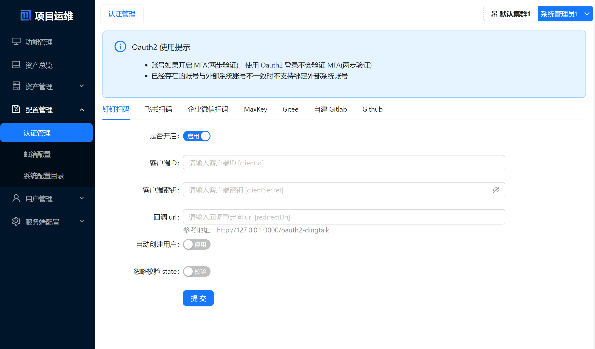
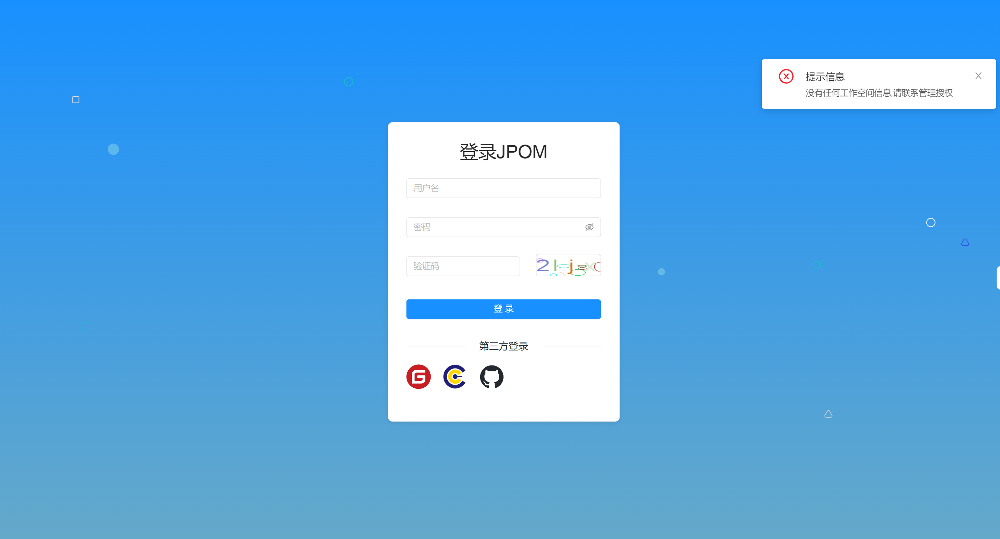
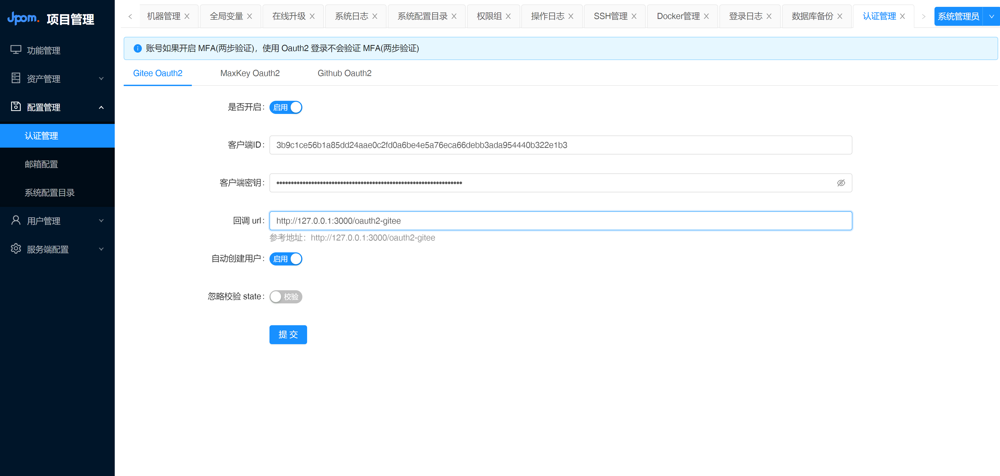
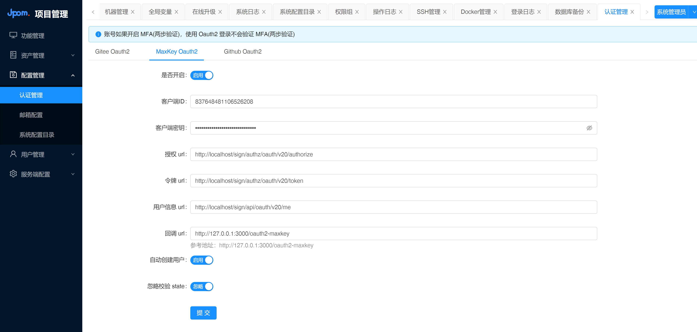
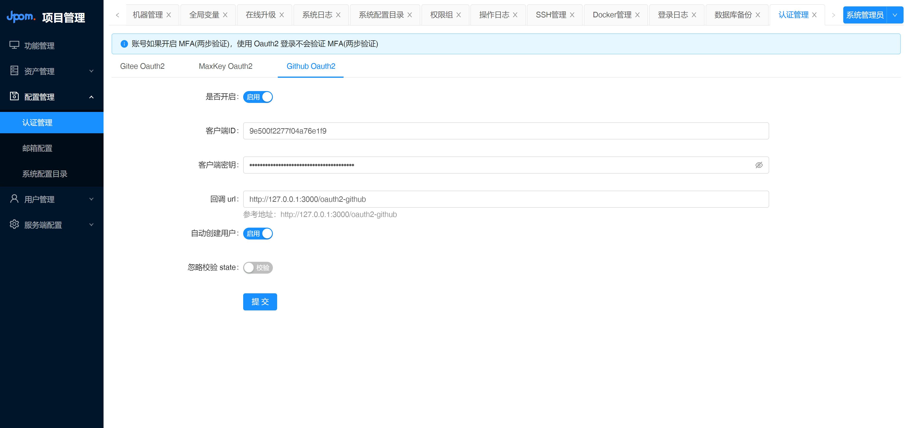

## 前言

Jpom 支持 Oauth2 登录，使用 [JustAuth](https://www.justauth.cn/) 第三方库实现，感谢有了此工具库让我们轻松实现 Oauth2 登录

目前支持 [MaxKey](https://www.maxkey.top/)、Github、Gitee、钉钉、飞书、企业微信、自建 Gitlab、**TOPIAM**

2.11.4 版本开始支持：钉钉

2.11.5 版本开始支持：飞书、企业微信、自建 Gitlab

2.11.12 版本开始支持：TOPIAM

::: tip 回调地址怎么填（最常见配不上的原因）
第三方平台要求填写的回调/重定向地址，格式是：

```text
http(s)://你的Jpom域名/oauth2-<平台标识>
```

平台标识就是【认证管理】里各平台的 provider 名：`gitee`、`github`、`dingtalk`、`feishu`、`wechat_enterprise`（企业微信）、**`mygitlab`（自建 Gitlab）**、`maxkey`、`topiam`。

举例：Jpom 部署在 `https://jpom.example.com`，配 Gitee 登录时回调地址填 `https://jpom.example.com/oauth2-gitee`；配自建 Gitlab 则填 `https://jpom.example.com/oauth2-mygitlab`。

（配置页每个平台下方的提示文案会直接显示该平台的回调地址，复制即可。）
如果用了二级路径或反向代理，请保证外部可访问地址与 Jpom 的代理路径配置一致。
:::

## 配置 Oauth2

路径：【系统管理】-> 【配置管理】->【认证管理】



开启 Oauth2 后


### 开启自动创建用户

使用 Oauth2 方式登录如果当前系统中还未存在对应的账号系统将自动创建一个对应用户名的账户，初次登录仅能自动创建账号。

自动创建账户后请联系管理员分配权限组才能正常进入系统




:::tip 注意
使用 Oauth2 方式登录如果对应账号开启了 MFA 两步验证将忽略验证
:::

## 配置参考





