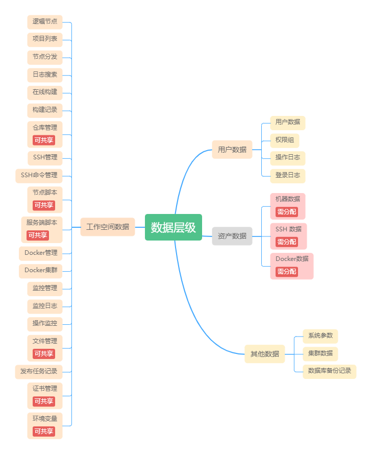
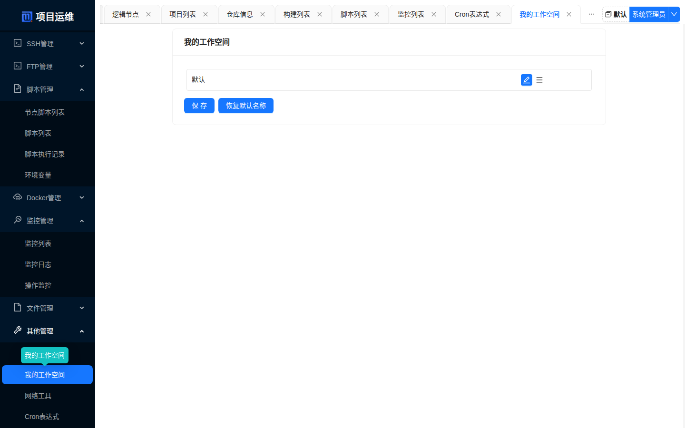
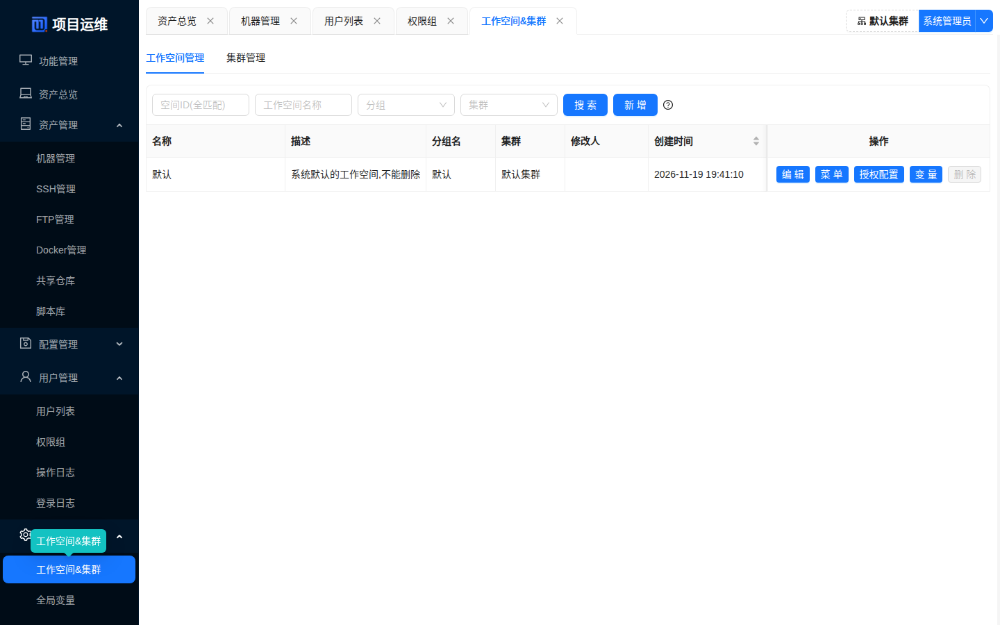
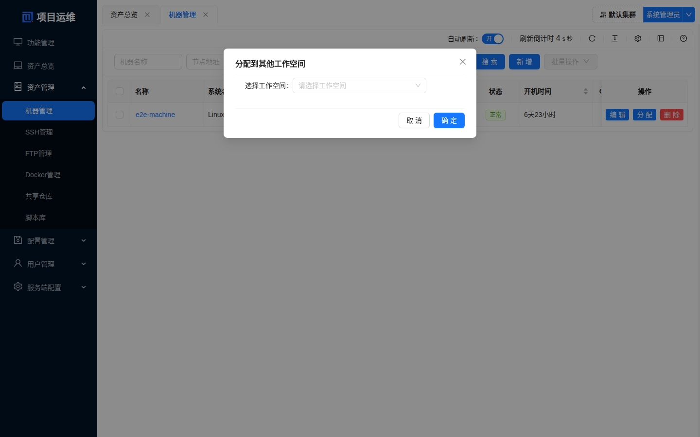
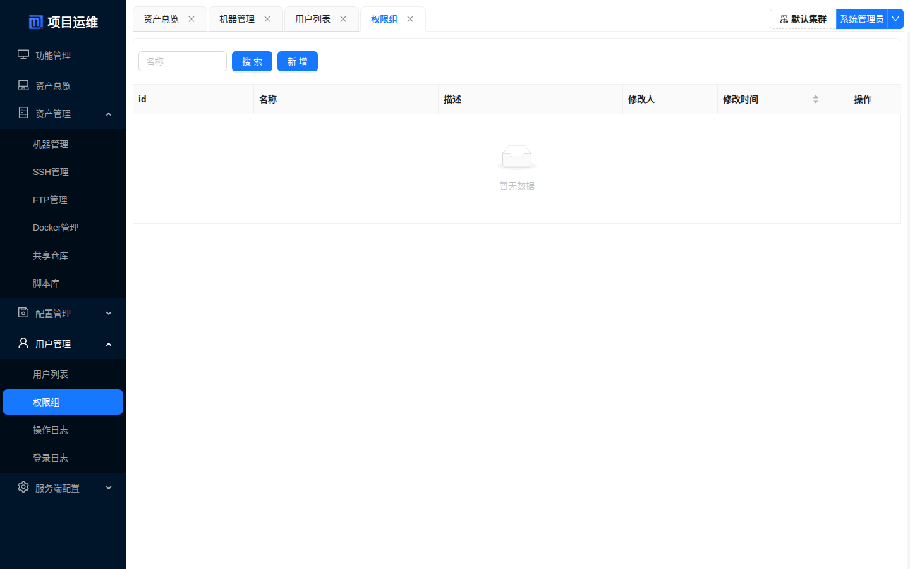

## 前言

使用 Jpom 您必须知道的一个概念就是工作空间，因为系统中的数据使用了工作空间来代替权限限制的功能。所以您必须理解并能善用工作空间才能更轻松的使用 Jpom

关于权限说明您可以看另一个文档：[权限说明](../020.用户&权限/00.权限说明.md)

## 数据层级

Jpom 服务端中的数据可以大概分为如下层级：用户数据、资产数据、其他（系统）数据、工作空间数据

如图所示：

**可共享**：是指可以跨工作空间使用的数据

**需分配**：数据默认是在系统级别，可以将数据分配到需要使用的工作空间来供其他用户使用

**普通用户**：仅能使用和管理授权工作空间下的数据

**超级管理员**：可以使用系统中的所有数据

**服务端管理员**：可以使用授权工作空间下的数据、资产数据、部分系统数据

-----------

工作空间自身数据是属于系统层级的数据。

但是比如下列数据属于工作空间层级下的：

- 逻辑节点
- SSH 数据（非资产管理）
- 容器数据（非资产管理）
- 项目数据
- 构建数据
- 仓库数据
- 脚本数据
- 监控数据
- 文件中心数据
- 证书数据
- 等

::: tip 总结
上述功能或者数据均表示需要绑定到指定工作空间
:::

## 在工作空间之间切换

右上角的工作空间按钮（默认显示「默认」）→ 下拉选择目标工作空间即可切换，当前页面数据会随之切换。

> 上图是【其他管理】->【我的工作空间】列表；日常切换工作空间用右上角那个「默认」按钮。

## 新建 / 编辑工作空间

【系统管理】->【服务端配置】->【工作空间&集群】->【工作空间管理】选项卡：

每个工作空间行内提供这些操作：

| 按钮 | 作用 |
| --- | --- |
| 编辑 | 改名称、描述等基础信息 |
| 菜单 | **控制该工作空间下显示哪些菜单**（想隐藏某些功能就点这里） |
| 授权配置 | 该工作空间内项目/分发使用的授权目录 |
| 变量 | 该工作空间的环境变量（构建、脚本、DSL 都可引用） |
| 删除 | 默认工作空间不可删除；有数据的空间需要先清理数据 |

::: warning 创建后不可随意删除
默认工作空间和系统内置空间不建议删除；删除前请确认空间内没有节点、项目、构建等数据，否则需要先逐个清理。
:::

## 把资产交给工作空间

工作空间本身不直接持有服务器，需要两步：

1. 【系统管理】->【资产管理】->【机器管理】里【新增】机器（或【快速安装】自动上报）
2. 在该机器行内点【分配】，选择目标工作空间 → 工作空间里就出现「逻辑节点」

同理，SSH / FTP / Docker 资产也都是在系统管理侧登记，再分配到工作空间使用。

## 给谁用：权限组

工作空间的「能不能看」由**权限组**决定：一个权限组 = 若干工作空间 + 每个工作空间的操作权限。
用户被加入权限组后，才能看到对应工作空间的数据。

操作路径：【系统管理】->【用户管理】->【权限组】->【新增】/【编辑】。

