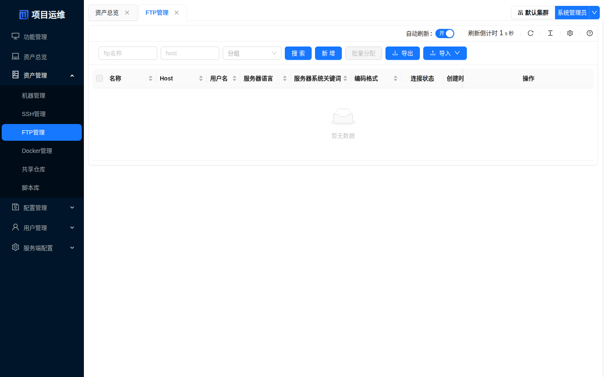
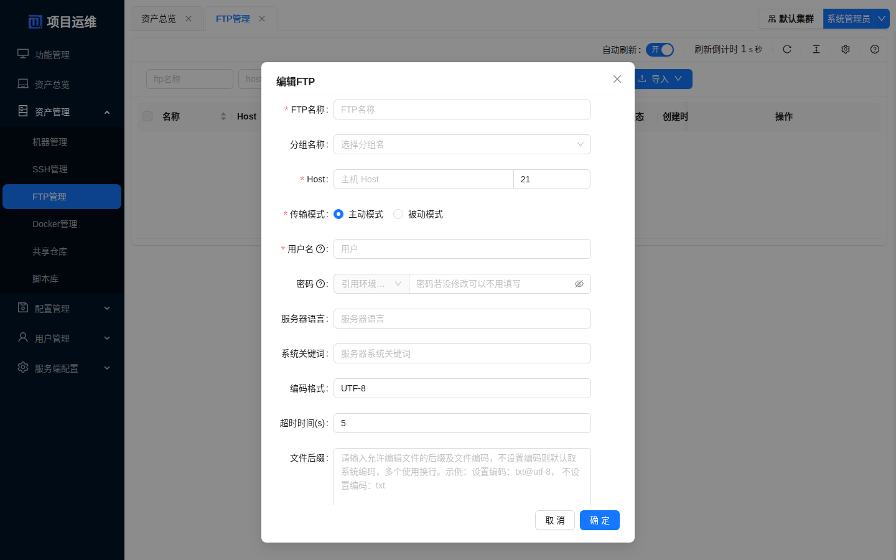
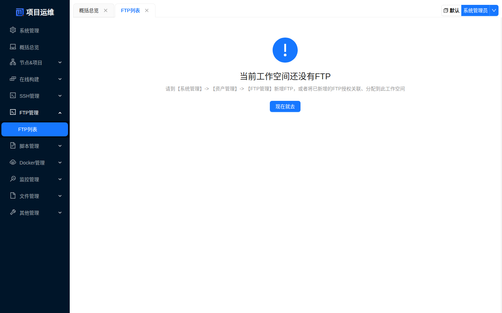

## 这个功能解决什么问题

一处登记 FTP 服务器，多个工作空间复用；改密码只改一次。
典型用途：

- 把前端静态资源 FTP 上传到 CDN / 老虚拟主机
- 从 FTP 取数（对账文件、报表）
- 作为【在线构建】的发布方式之一（构建产物直接推 FTP）

## 操作路径

| 想做的事 | 真实路径 |
| --- | --- |
| 登记 FTP 服务器 | 【系统管理】->【资产管理】->【FTP管理】->【新增】 |
| 分配给工作空间 | 同上，行内【分配】 |
| 配置该 FTP 在各工作空间可用的目录 | 同上，行内【关联】-> 对应工作空间 ->【配置】 |
| 在工作空间里用 | 【FTP管理】->【FTP列表】 |

## 新增一个 FTP

点【新增】，弹窗标题为「编辑FTP」（新增与编辑共用同一个弹窗）：

| 字段 | 必填 | 默认值 | 说明 |
| --- | --- | --- | --- |
| FTP名称 | 是 | — | 显示名，建议带环境，如 `prod-static` |
| 分组名称 | 否 | — | 虚拟分组，仅用于列表归类 |
| Host | 是 | — | 主机名或 IP |
| 端口号 | 是 | `21` | SFTP 一般是 22，按服务端实际填 |
| 传输模式 | 是 | 主动模式 | 内网/NAT 后面常见要选**被动模式**，否则能登录但列不出目录 |
| 用户名 | 是 | — | 支持引用工作空间变量 `$ref.wEnv.xxx` |
| 密码 | 是（新增时） | — | 编辑时留空表示不改；支持 `$ref.wEnv.xxx` |
| 服务器语言 | 否 | — | 用于识别返回消息的语言，一般留空 |
| 系统关键词 | 否 | — | 用于识别服务器类型，一般留空 |
| 编码格式 | 否 | `UTF-8` | 中文文件名乱码时改成 `GBK` 试试 |
| 超时时间(s) | 否 | `5` | 网络慢可调大 |
| 文件后缀 | 否 | — | 允许在线编辑的后缀，写法 `txt@utf-8`、`bat@GBK`，不写编码则用系统编码 |

::: danger 文件后缀这里有个坑
这个【文件后缀】**只对系统管理侧的 FTP 文件管理生效**。
工作空间里要能在线编辑文件，必须到【关联】-> 对应工作空间 ->【配置】里再配一次。
:::

## 分配给工作空间

新增完不会自动可用。在该行点【分配】选择工作空间（也支持勾选多行后【批量分配】）。

分配之后，工作空间里就能看到它：

如果工作空间里是上面这个空页面，说明还没分配，页面上的提示也直接给了路径：
「请到【系统管理】->【资产管理】->【FTP管理】新增FTP，或者将已新增的FTP授权关联、分配到此工作空间」。

## 关联与授权目录

点行内【关联】，能看到这个 FTP 被分配到了哪些工作空间。
在每个工作空间那一行点【配置】，设置**该工作空间**允许访问的目录和可编辑后缀 —— 这是安全边界，不配就无法在工作空间里上传/删除文件。

::: warning 为什么每个工作空间要单独配
资产是「全局」的，但授权目录是「按工作空间」隔离的。
一个 FTP 给 A 团队只读 `/public`，给 B 团队可写 `/release`，就是靠这里区分。
:::

## 编辑与删除

| 操作 | 说明 |
| --- | --- |
| 编辑 | 改连接信息；密码留空表示保持原密码（想清空点输入框右侧的【清除】） |
| 删除 | **已经分配到工作空间的 FTP 不能直接删**，要先到各工作空间里删除后再删资产 |
| 导出 / 导入 | 顶部【导出】可导出配置；【下载导入模板】后可批量导入 |

## 常见问题

**Q：状态显示「无法连接」但用 FileZilla 能连**

A：① 传输模式换成**被动模式**；② 检查 Jpom 服务端所在服务器到该 FTP 的端口是否放通（被动模式还需要放通数据端口范围）；③ 超时时间调大。

**Q：工作空间里【文件】按钮是灰的**

A：没配授权目录。到【关联】-> 对应工作空间 ->【配置】里加上目录。

**Q：中文文件名乱码**

A：把【编码格式】改成 `GBK`（老服务器常见），或把服务端改成 UTF-8。

**Q：想用 SFTP 而不是 FTP**

A：SFTP 请用【SSH管理】的 SSH 资产（支持文件管理与终端），FTP 资产是给 FTP/FTPS 协议用的。

## 相关文档

- [FTP 授权与文件管理](/pages/ftp/manage/)
- [资产说明](/pages/350118/)
- [在线构建：发布到 FTP](/pages/build-guide/)
