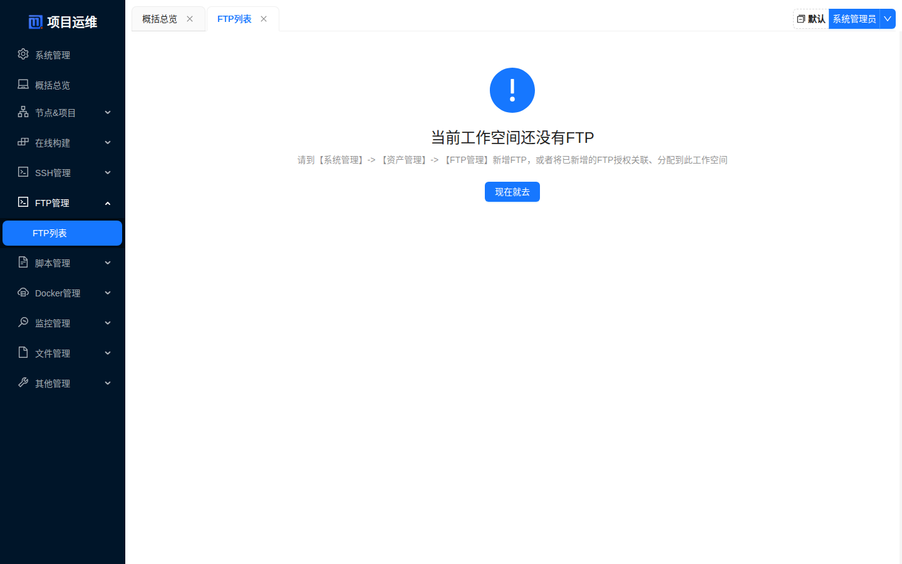

## 三层关系先理清

```text
FTP 资产（系统管理里登记连接信息）
   └── 分配到工作空间（谁能用）
          └── 授权目录 + 可编辑后缀（能用哪些目录、哪些文件能在线改）
```

少了最后一层，工作空间里能看见 FTP，但【文件】按钮是灰的、上传会失败。

## 给某个工作空间配授权

1. 【系统管理】->【资产管理】->【FTP管理】
2. 找到目标 FTP，点行内【关联】
3. 在弹窗里找到对应工作空间，点行内【配置】
4. 填入允许访问的目录（一个 FTP 账户的根路径下的相对或绝对目录，按页面提示填）与可编辑后缀
5. 保存

::: warning 只配一层不够
- 资产侧弹窗里的【文件后缀】= 系统管理侧的文件管理用
- 工作空间侧的配置 = 工作空间里的文件管理用

两处都要配，否则会出现「资产里能改文件、工作空间里改不了」的错觉。
:::

## 在工作空间里使用

【FTP管理】->【FTP列表】，行内操作：

| 按钮 | 作用 |
| --- | --- |
| 文件 | 打开文件管理抽屉：浏览目录、上传、下载、删除、在线编辑（受后缀限制） |
| 编辑 | 只改**当前工作空间内**这个 FTP 的显示名称；连接信息要去系统管理改 |
| 更多 | 删除、终端日志 |



::: tip 编辑按钮的边界
工作空间里的【编辑】弹窗会明确提示：连接信息、授权目录、文件后缀都要去【系统管理】->【资产管理】->【FTP管理】改。
这里只允许改「这个工作空间里叫它什么」。
:::

## 作为构建的发布目标

【在线构建】新增构建 -> 第 4 步「发布操作」-> 发布方式选 **FTP**：

- 只能选**已配置授权目录**的 FTP（没配的选择框里不会出现）
- 一次选多个 FTP 时，发布目录只显示第一项的目录，但**每个 FTP 都要有自己的授权目录**

## 常见问题

**Q：工作空间里点【文件】提示没有权限 / 目录不存在**

A：授权目录没配或配错。注意路径要落在该 FTP 账号能访问的目录下，别写宿主机路径。

**Q：能上传但不能在线编辑**

A：后缀没配。到工作空间侧的配置里加上 `txt@utf-8` 这类规则（分隔符是 `@`，不是冒号）。

**Q：删不掉 FTP 资产**

A：先看【关联】里还有哪些工作空间在用，逐个在工作空间里删除，最后才能删资产。

**Q：上传大文件失败**

A：确认该 FTP 服务端的大小限制和超时；Jpom 侧可把【超时时间】调大。

## 相关文档

- [新增 FTP 资产](/pages/ftp/add/)
- [在线构建：从仓库到发布](/pages/build-guide/)
- [资产说明](/pages/350118/)
