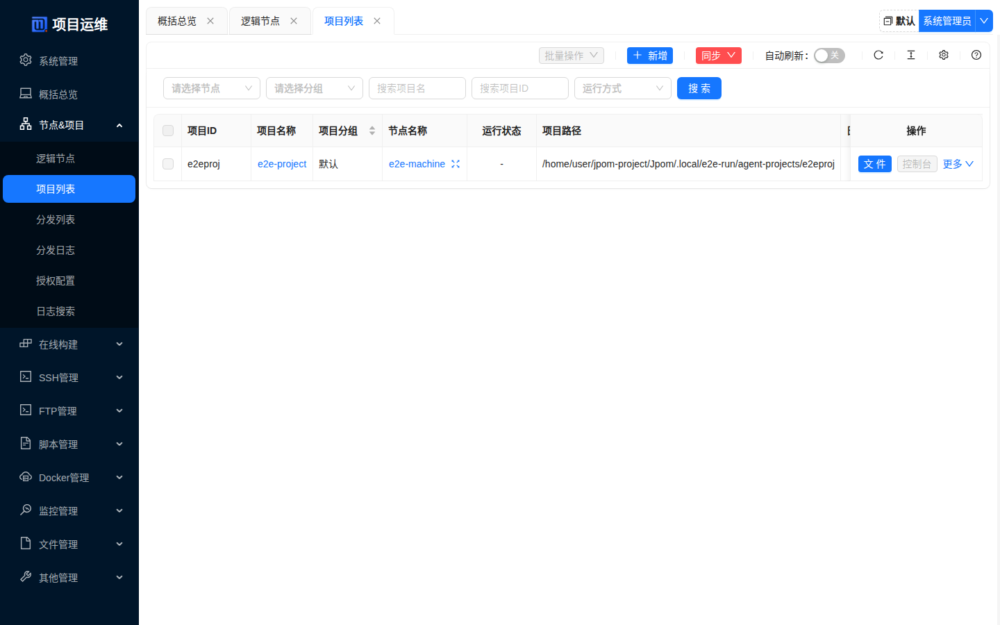
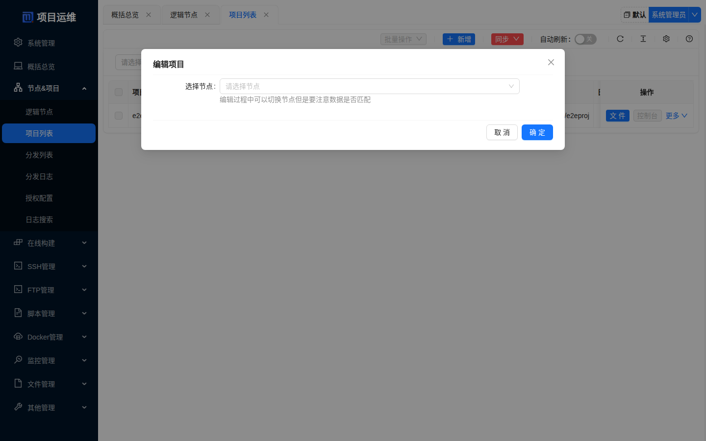
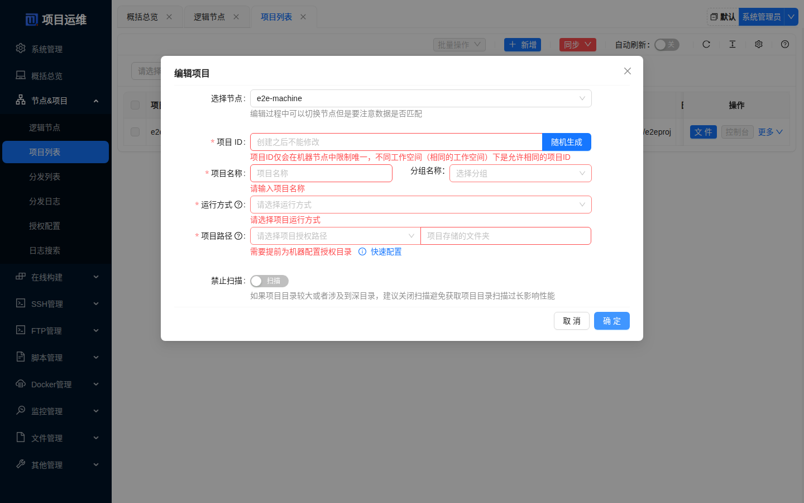
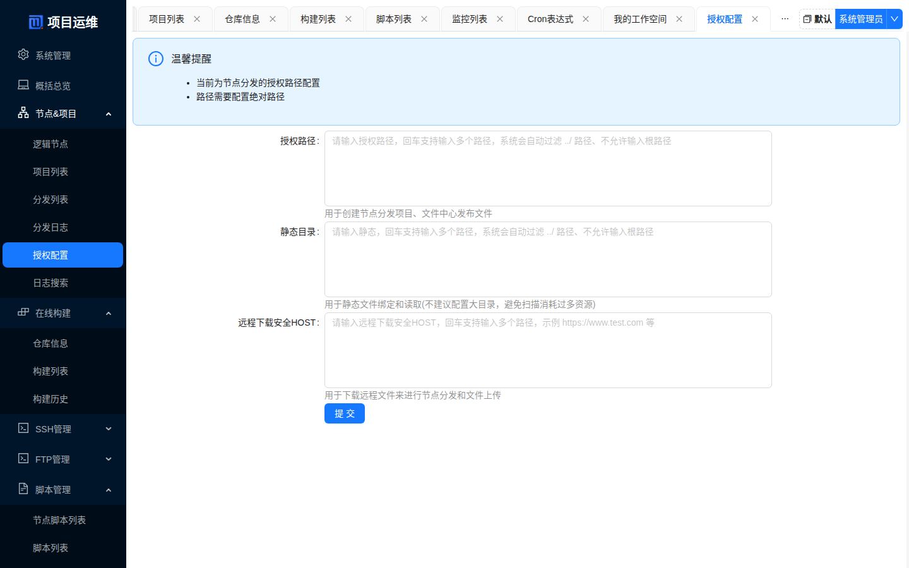
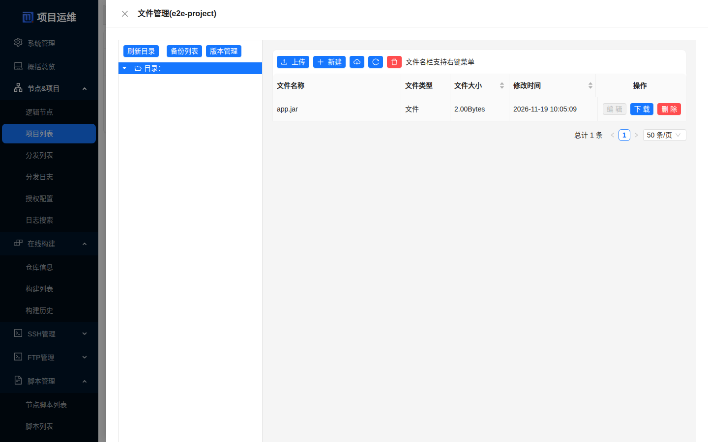

## 这个页面能帮你做什么

「节点项目」是 Jpom 里最核心的对象：**一台服务器（机器节点）上的一个进程，被 Jpom 托管起来**。
托管之后您就可以在网页上完成：启动、停止、重启、看控制台日志、上传/下载文件、改配置、看端口和进程号。

::: tip 先记住三个词
- **机器（资产机器）**：安装并启动了插件端的那台服务器，在【系统管理】->【资产管理】->【机器管理】里维护
- **逻辑节点**：把机器「分配」给某个工作空间后的身份，在【节点&项目】->【逻辑节点】里看到
- **节点项目**：逻辑节点下面的具体项目，就是本页要讲的内容
:::

## 操作路径

| 想做的事 | 真实操作路径 |
| --- | --- |
| 看所有项目 | 左侧菜单【节点&项目】->【项目列表】 |
| 看某个节点下的项目 | 左侧菜单【节点&项目】->【逻辑节点】-> 找到节点 -> 点击【管理】 |
| 给项目准备存放目录 | 左侧菜单【节点&项目】->【授权配置】 |

## 新增项目（分两步）

### 第一步：选节点

点击页面右上角的【+ 新增】，会先弹出「编辑项目」窗口，第一步只让您选节点：

::: warning 为什么先选节点
项目是「绑定在节点上」的，选好节点后，下面的授权目录、日志目录等下拉选项都会按这个节点来取。
窗口里的提示也写了：编辑过程中可以切换节点，但要注意两个节点的数据是否匹配。
:::

选好节点点【确定】，进入第二步。

### 第二步：填写项目信息

| 字段 | 必填 | 说明 |
| --- | --- | --- |
| 项目 ID | 是 | 创建后**不能修改**。只在同一台机器内唯一（不同工作空间允许相同 ID）。可点【随机生成】 |
| 项目名称 | 是 | 显示用名称，建议和业务一致 |
| 分组名称 | 否 | 只是列表上的「虚拟分组」，不是独立管理的数据 |
| 运行方式 | 是 | 决定 Jpom 用什么命令拉起这个项目，见下表 |
| 项目路径 | 是 | 由「授权路径」+「项目文件夹」拼成，最终目录会显示在下方 |
| 禁止扫描 | 否 | 目录特别大（如前端产物、日志目录）时建议打开，避免扫描耗时 |

运行方式怎么选：

| 运行方式 | 适用场景 |
| --- | --- |
| **Dsl** | 自定义脚本项目（Python、Node.js、Go、接口探活、Elasticsearch 等），**官方推荐** |
| **Jar** | 普通 Spring Boot 打出来的 `java -jar xxx.jar` |
| **ClassPath** | `java -classpath` 方式启动的老项目 |
| **JavaExtDirsCp** | `java -Djava.ext.dirs=lib -cp conf:run.jar` 方式（老项目） |
| **File** | 纯静态文件/日志目录，**没有启动、停止、控制台**功能 |
| **Link** | 软链的项目，类似项目副本，复用其他目录的文件 |
| **JarWar** | Spring Boot 的 war 包（不推荐） |

::: danger 项目路径填不进去？
【项目路径】的下拉里没有可选目录，说明这台机器还没有配「授权目录」。
去【节点&项目】->【授权配置】把存放项目的绝对路径加进去（回车可输入多个），提交后再回来新增项目。

:::

点【确定】保存后，会打开项目详情页，可以继续补充下面的高级项。

## 项目详情里的高级项

| 分组 | 字段 | 说明 |
| --- | --- | --- |
| 基础 | 日志目录 | 控制台日志存放目录，默认在插件端数据目录下 `{projectId}/{projectId}.log` |
| 基础 | 日志编码格式 | 一般是 UTF-8；配了之后「日志搜索」也会按这个编码读 |
| 启动 | mainClass | Jar 模式可不填 |
| 启动 | JVM 参数 | 如 `-Xms512m -Xmx512m` |
| 启动 | args 参数 | 传给 main 方法的参数，如 `--server.port=8080` |
| 启动 | DSL 环境变量 | 仅 Dsl 模式，形如 `key1=values1&key2=values2` |
| 行为 | 自启动 | 插件端启动时若项目未运行则尝试启动（不等于服务器开机自启） |
| 行为 | 触发器 token | 项目启动/停止/重启/文件变动时回调您配置的地址（GET 请求） |

::: tip DSL 模式的写法
DSL 项目用 **YAML** 描述启动/停止/状态命令，其中 `scriptId` 指向节点脚本、脚本库脚本或项目目录里的脚本文件；
启动脚本执行完，**最后一行必须输出 `running` 和一个 PID**，否则项目状态会一直是「未运行」。
详细写法见 [DSL 介绍](/pages/FQA/DSL/)。
:::

## 日常操作

在【项目列表】每行的【操作】列：

| 按钮 | 作用 |
| --- | --- |
| 文件 | 打开项目文件管理：上传、新建、删除、备份列表、版本管理 |
| 控制台 | 实时看控制台日志、执行启动/停止/重启（File 类型项目没有此按钮） |
| 更多 | 触发器、项目日志、复制、逻辑删除、彻底删除、迁移工作空间、置顶/上移/下移 |

顶部还有这些批量能力：**批量启动 / 批量重启 / 批量关闭 / 同步缓存 / 导出 / 导入**。

::: danger 删除前请分清两个动作
- **逻辑删除**：只从 Jpom 列表移除，**项目文件、日志都保留**
- **彻底删除**：会连项目文件、项目日志、日志备份一起删掉，**不可恢复**

建议顺序：先【文件】清理数据 -> 再逻辑删除 -> 确认无误再彻底删除。
:::

## 常见问题

**Q：新增项目提示「项目 ID 已经存在」？**
A：同一个机器节点内项目 ID 唯一。换个 ID，或在【项目列表】按项目 ID 搜索确认是否已存在（可能是没删干净的历史数据）。

**Q：新增项目提示目录被占用 / 找不到项目？**
A：一般是上一次删除没清理干净，或数据缓存不一致。先点【同步缓存】；仍不对就到【系统管理】->【资产管理】->【机器管理】-> 选中机器 -> 【缓存监控】里看「孤独数据」。

**Q：项目一直是「未运行」，但进程其实在跑？**
A：File 类型项目天然没有状态；Dsl 项目请检查脚本最后一行是否为 `running` + PID。

**Q：改了 JVM 参数不生效？**
A：参数在项目详情里保存后，需要**重启项目**才会用新的启动命令。

## 相关文档

- [逻辑节点](/pages/285484/)：节点怎么上线、怎么分配工作空间
- [节点脚本](/pages/8a95bf/)：用脚本+Dsl 方式托管非 Java 项目
- [节点分发](/pages/e35370/)：同一个项目要发布到多台机器
- [日志搜索](/pages/c5cbe6/)：集中查看项目日志文件
