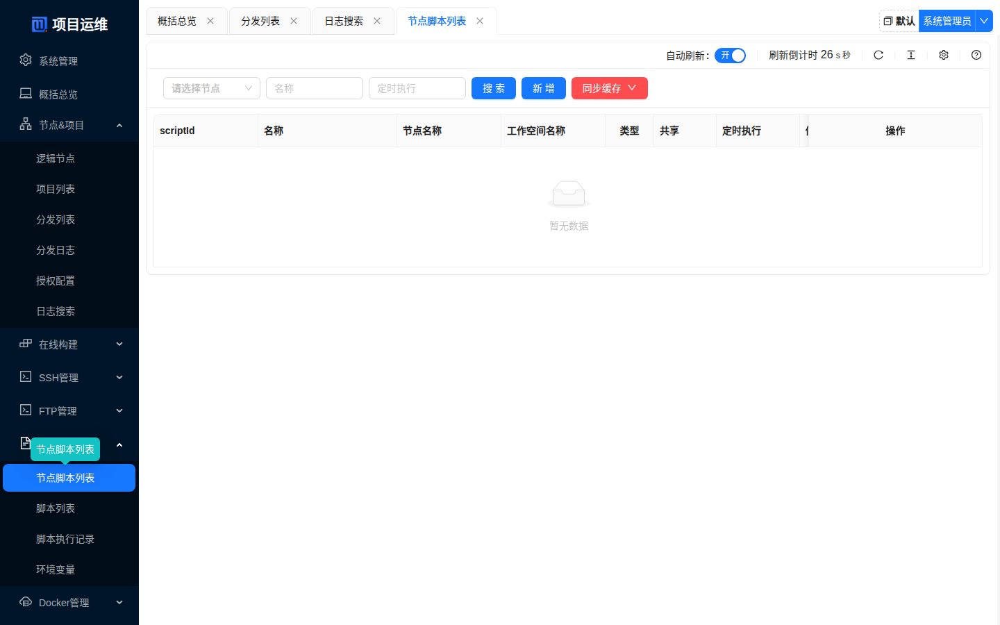
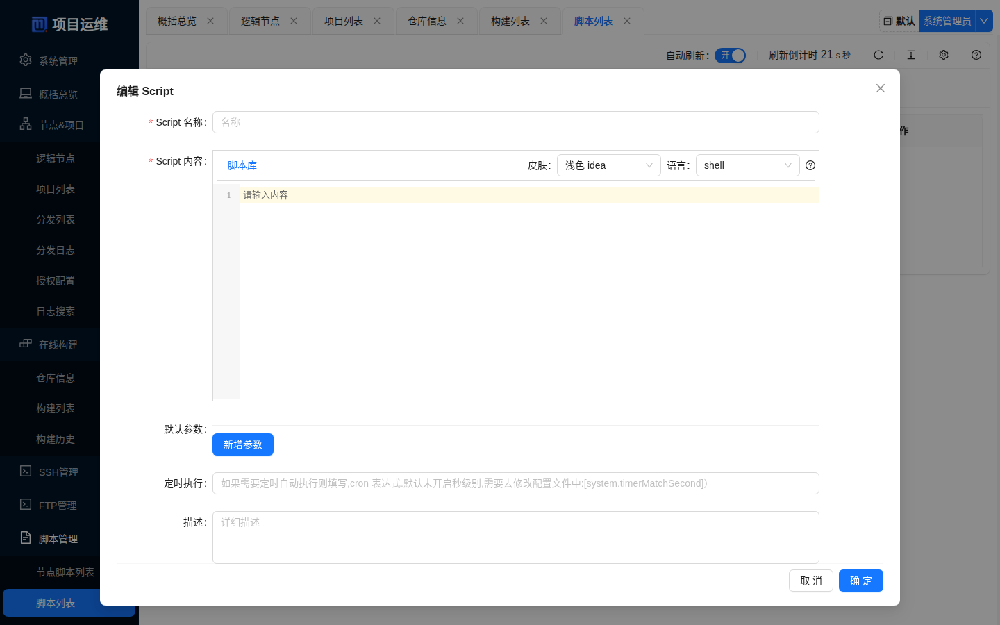
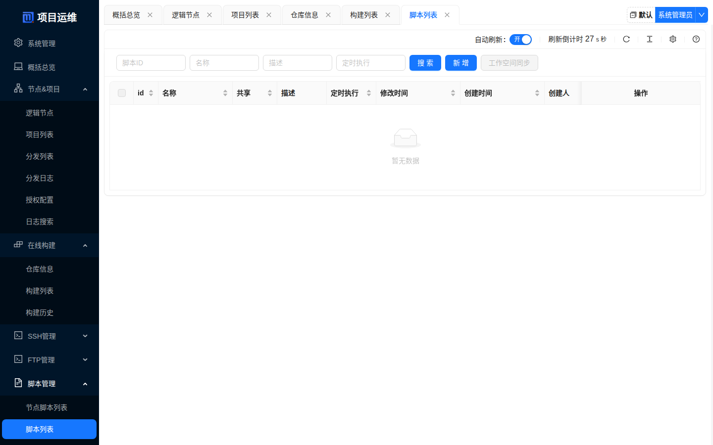

## 这个页面能帮你做什么

脚本管理用来把**一段命令**变成 Jpom 里可复用、可定时、可跨节点执行的「脚本」。
最典型的三个用法：

1. 定时任务：每天凌晨备份数据库、清理日志
2. 发布钩子：构建完/发布后执行一段重启脚本
3. 托管非 Java 项目：作为 **Dsl 运行方式**项目的启动/停止脚本

## 操作路径

| 菜单 | 真实路径 | 说明 |
| --- | --- | --- |
| 节点脚本列表 | 【脚本管理】->【节点脚本列表】 | 已下发到节点上的脚本（真正会在服务器上执行的） |
| 脚本列表 | 【脚本管理】->【脚本列表】 | 工作空间级的脚本模板，编辑后可同步/分发到节点 |
| 脚本执行记录 | 【脚本管理】->【脚本执行记录】 | 每次执行的时间、节点、退出码、输出 |
| 环境变量 | 【脚本管理】->【环境变量】 | 工作空间的变量，脚本里可直接引用 |



::: tip 两个列表的区别
**脚本列表**是「模板」，**节点脚本列表**是「落到机器上的实体」。
在脚本列表里改完脚本，需要让节点同步过去才会生效；节点数据看着不对时，点【同步缓存】从节点重新拉一次。
:::

## 新增一个脚本

在【脚本管理】->【脚本列表】点【新增】：



| 字段 | 说明 |
| --- | --- |
| Script 名称 | 脚本名，列表和引用时展示的就是它 |
| 脚本库 | 可以从【系统管理】->【资产管理】->【脚本库】里挑一个现成脚本 |
| 语言 / 解释器 | 决定用 shell、python、node 等哪个解释器执行 |
| 定时执行 | 填 **cron 表达式**就变成定时任务；不填就是手动执行 |
| 描述 | 给自己看的备注 |
| 全局 / 当前工作空间 | 全局脚本所有工作空间可见；否则只在当前工作空间可见 |
| 分发节点 | 选择这个脚本要下发到哪些逻辑节点（不选就是本地/服务端脚本） |



::: warning 支持「每秒」执行的坑
cron 默认**不支持秒级**（6 位表达式会被当成 5 位解析）。
要开秒级，请改**服务端** `conf/application.yml`：

```yaml
jpom:
  system:
    timer-match-second: true
```

改完重启服务端生效。注意：老文档/旧页面提示里写的 `system.timerMatchSecond` 是旧写法，按上面的键名来。
:::

## 定时任务的写法建议

1. **先手动跑通再开定时**：写完后先点【执行】看一遍输出，确认路径、变量、权限都对
2. **脚本里写绝对路径**：定时任务的 PATH 可能和交互式登录不同
3. **输出要可追溯**：把关键步骤 echo 出来，执行记录里能直接看到
4. **失败要能发现**：配合【监控管理】的 WebHooks 或【配置管理】->【邮箱配置】做失败告警

一个每天 02:30 备份 MySQL 的示例（详见[实践案例](/pages/practice/node-script-backup-docker-mysql/)）：

```bash
#!/bin/bash
set -e
DATE=$(date +%F)
docker exec mysql sh -c 'mysqldump -uroot -p"$MYSQL_ROOT_PASSWORD" --all-databases' | gzip > /data/backup/mysql-$DATE.sql.gz
find /data/backup -name "mysql-*.sql.gz" -mtime +7 -delete
echo "backup done: mysql-$DATE.sql.gz"
```

## 执行与排查

- 在【节点脚本列表】每行点【执行】可立即跑一次，结果在【脚本执行记录】里看
- 执行记录里关注三样：**退出码、耗时、输出**；退出码非 0 就是失败
- 脚本在服务器上是以**插件端进程的用户**运行的，权限问题优先查用户和目录权限

## 常见问题

**Q：脚本能跑，但定时不触发？**
A：先确认 cron 表达式是 5 位还是在秒级配置下写的 6 位；再确认脚本「状态/定时执行」是开启的。

**Q：脚本里用 `$JAVA_HOME` 之类的变量取不到？**
A：定时执行不会加载交互式 shell 的 profile。请在脚本开头显式设置，或改用【脚本管理】->【环境变量】里配置的变量（脚本里可直接引用）。

**Q：节点脚本列表里的 scriptId 有什么用？**
A：Dsl 项目的 YAML 里就是用 `scriptId` 引用脚本的，可以在脚本编辑弹窗里看到这个 ID。

## 相关文档

- [节点项目](/pages/b3e508/)：Dsl 运行方式怎么引用脚本
- [节点脚本定时备份 MySQL 实践](/pages/practice/node-script-backup-docker-mysql/)
