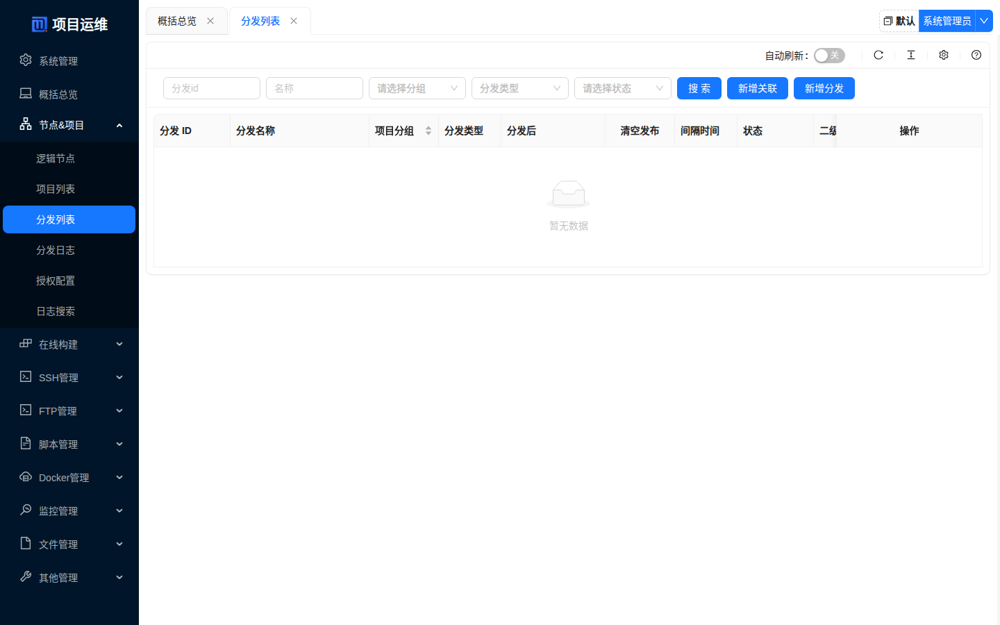
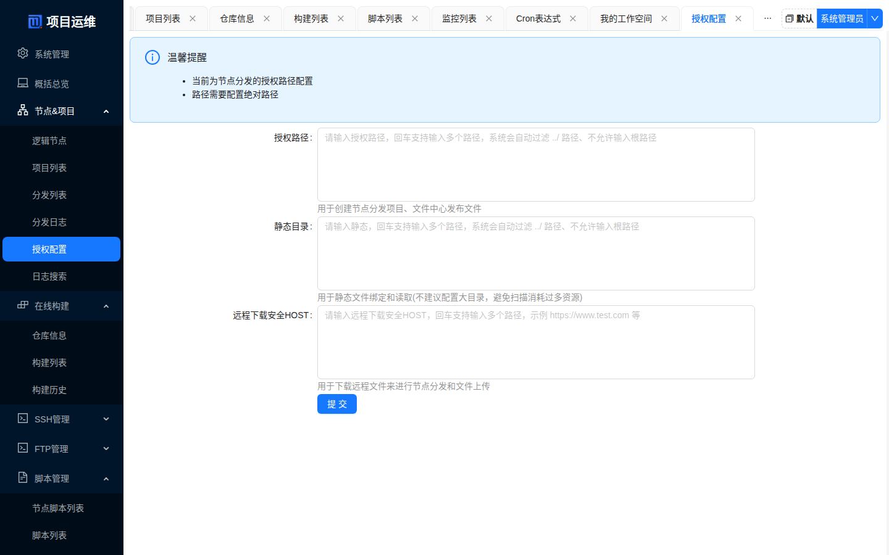

## 这个页面能帮你做什么

「节点分发」解决的是**一个项目要跑在多台服务器上**的场景：集群部署、多机房、灰度发布。
用它可以把同一个项目统一下发到多个节点，并统一发布文件，不用一台台去传、去重启。

## 操作路径

| 想做的事 | 真实操作路径 |
| --- | --- |
| 看所有分发项目 | 【节点&项目】->【分发列表】 |
| 看分发执行结果 | 【节点&项目】->【分发日志】 |
| 配置分发可用的目录 | 【节点&项目】->【授权配置】（**不是**「分发授权配置」，这是老菜单名） |

列表字段速查：

| 列 | 含义 |
| --- | --- |
| 分发 ID | 等同项目 ID，创建后不能改 |
| 分发类型 | **独立**：由分发创建并管理；**关联**：关联已存在的节点项目 |
| 分发后 | 发布完文件后对项目做什么（如顺序重启） |
| 清空发布 | 上传前先清空项目目录再放新文件 |
| 间隔时间 | 多个节点顺序操作时，每个节点之间等待多久（建议 10 秒以上） |
| 二级 | 发布到项目的二级目录，不填就是项目根目录 |

## 创建分发的两种方式

### 方式一：新增分发（全新创建）

点【新增分发】，等价于「创建一个项目 + 同时下发到多台机器」。
填的内容和[新增项目](/pages/b3e508/)基本一致（分发 ID、分发名称、运行方式、项目路径、JVM 参数等），额外多两项：

- **分发节点**：勾选要发布到哪些节点项目，**至少选 1 个**
- **分发后操作**：发布完成后是否重启/顺序重启

### 方式二：新增关联（复用已有项目）

点【新增关联】，把**已经存在**的节点项目关联成一个分发对象，之后统一发布。
适合「项目早就建好了，只是想把它们拉到一个分发里管理」的情况。

::: warning 前提：先有授权目录
创建独立分发项目时，如果【项目路径】下拉是空的，先到【节点&项目】->【授权配置】把目录加进去
（这里的「授权路径」说明写着：用于创建节点分发项目、文件中心发布文件）。

:::

## 发布与回滚

1. 在【分发列表】找到分发项目 -> 【更多】-> 可用【编辑】【取消分发】【删除】【释放】【彻底删除】【解绑】
2. 发布完成后到【分发日志】看每个节点的结果：分发方式、分发结果、耗时、文件大小、开始/结束时间
3. 某个节点失败时，先看【分发日志】里的「分发状态消息」，再单独处理那一台

::: danger 四个「删」别混
- **取消分发**：中止正在进行的下发
- **删除**：移除分发信息，节点下的项目**还会保留**
- **释放**：释放分发关系，项目信息保留，需要时到节点里再删
- **彻底删除**：连节点上的项目文件一起删，**不可恢复**
:::

## 常见问题

**Q：提示「至少选择 1 个节点项目」？**
A：分发必须挂至少一个节点项目。先去【项目列表】把项目建好，或用【新增分发】一次建出来。

**Q：顺序重启时后面节点的项目起不来？**
A：把【间隔时间】调大。顺序重启会等上一个节点启动完成再关下一个节点，间隔太短就会互相踩。

**Q：发布后文件没变？**
A：检查是否勾了【清空发布】导致旧文件先被删；以及【二级目录】是否填错（填了就会发布到子目录）。

## 相关文档

- [节点项目](/pages/b3e508/)：单个项目的创建与操作
- [分发介绍（历史文档）](/pages/541f19/)：早期版本的分发概念说明，仅供了解背景
- [在线构建并发布到节点](/pages/practice/build-node-ssh-release/)：构建完自动把产物发到节点
