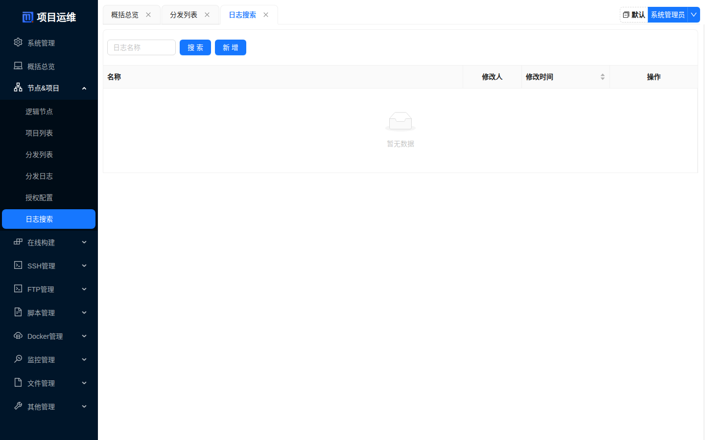

## 这个页面能帮你做什么

「日志搜索」把**多个节点、多个项目的日志文件**集中到一个页面里查。
不用 SSH 登录服务器、不用记住日志路径，输入关键字就能看，还能按项目/节点筛选。

典型用法：线上报错后，直接在网页上搜 `Exception`、订单号、traceId。

## 操作路径

【节点&项目】->【日志搜索】

列表很简单：**名称（您给这个搜索任务起的名字）、修改人、修改时间、操作**。

## 新增一个日志搜索

点【新增】，弹窗里填：

| 字段 | 必填 | 说明 |
| --- | --- | --- |
| 日志项目名称 | 是 | 给这个搜索任务起名，例如「订单服务-生产」 |
| 绑定节点 | 是 | 先选**节点**，再选该节点下的**项目**；至少选一组 |
| 搜索查看 | — | 保存后进入查看界面，按关键字检索日志内容 |

一个任务可以绑定多组「节点 + 项目」，这样一次搜索就能跨多个服务查。

## 日志文件到底在哪

知道位置，排查问题时能更快：

| 内容 | 默认位置 |
| --- | --- |
| 控制台日志 | 插件端数据目录下的 `project-log/{项目ID}/{项目ID}.log` |
| 日志备份 | 同目录下的 `back/` 子目录（按项目日志备份配置滚动） |

::: tip 想改位置和备份策略
- **日志目录 / 编码格式**：项目详情里改（见[节点项目](/pages/b3e508/)）
- **备份频率、备份大小、保留天数、是否落盘**：属于**插件端**的项目日志配置，在
  `conf/application.yml` 的 `jpom.project.log.*`（如 `auto-backup-console-cron`、`auto-backup-size`、`save-days`）。
  改完重启插件端生效。
:::

::: warning 中文乱码怎么办
日志文件编码不是 UTF-8（例如 Windows 下 GBK）时，先到项目详情把【日志编码格式】设成实际编码，
「日志搜索」读取时会跟随该编码。
:::

## 常见问题

**Q：搜索没有结果，但文件里明明有？**
A：依次确认：① 绑定的节点/项目对不对；② 日志编码格式是否匹配；③ 该项目的控制台日志是否被关闭或已滚动删除；④ 关键字是否被分词（先试完整单词或异常类名）。

**Q：提示「至少选择一个节点和项目」？**
A：新增时必须同时选中节点和它下面的项目，只选节点不算数。

**Q：日志文件太大，打开很慢？**
A：在项目详情里打开【禁止扫描】避免目录扫描；日常检索尽量用具体关键字而不是空查询。

## 相关文档

- [节点项目](/pages/b3e508/)：日志目录、日志编码格式、禁止扫描
- [项目监控与通知实践](/pages/practice/monitor-notice/)：项目状态异常时发告警
