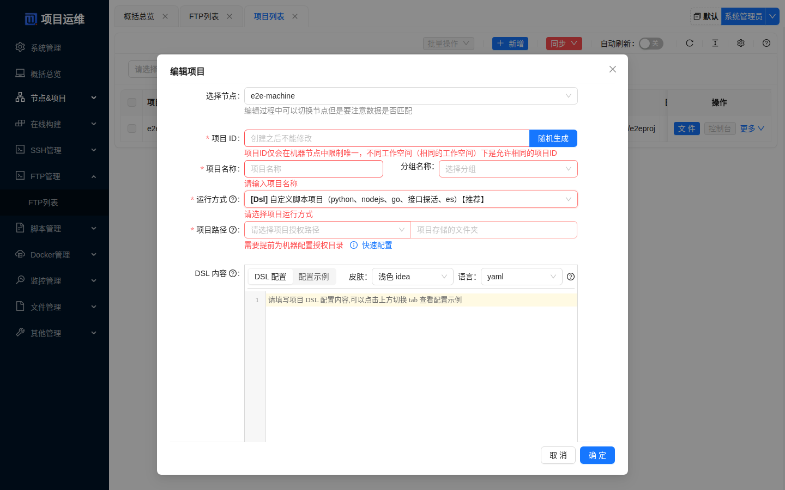
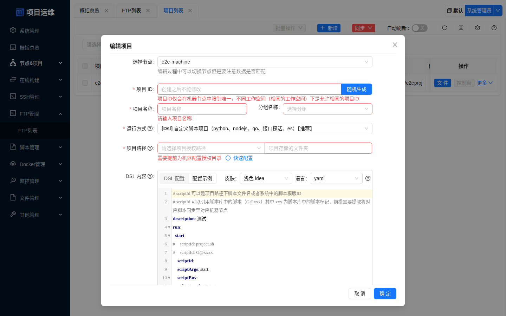

## 一句话理解 DSL

在 Jpom 里，**DSL 是一段 YAML 配置**：它告诉 Jpom「启动 / 查状态 / 停止这个项目时，去执行哪个脚本、带什么参数、在哪个目录执行」。

它本身不跑业务，只做**流程编排**。真正的动作由脚本完成，脚本可以是节点脚本、脚本库里的脚本，也可以是项目目录里的一个 `.sh`。

::: tip 和「脚本」的区别
- **节点脚本**：一段会被执行的命令（Jpom 里独立管理、可定时、可分发）
- **DSL**：一份「哪个操作调哪个脚本」的映射表，引用上面的脚本

所以 DSL 项目的本质是：**用脚本把非标准应用接进 Jpom 的生命周期管理**。
:::

## 为什么需要它

Jpom 能直接管理 Jar/War 这类标准 Java 项目，但实际环境里还有大量「非标准」的进程：

| 场景 | 用 DSL 怎么做 |
| --- | --- |
| 非 Java 应用（Go、Node、PHP、Python、Rust 二进制） | 脚本里写启动命令 + `pgrep` 查进程 |
| 中间件（Elasticsearch、Nacos、Canal、Tomcat、Redis） | 复用官方 `startup.sh` 或自写启停脚本 |
| 接口探活、假死监控 | `status` 流程里写 `curl`，返回非 0 就判定异常 |
| 需要特殊环境变量 / 工作目录的程序 | YAML 里配 `scriptEnv`、`execPath` |
| 已有运维脚本体系 | 直接引用现成脚本，不重写 |

::: warning 不要用它做这些
- **不需要托管进程的静态站点**：用 `File` 运行方式即可，没有启停概念
- **标准 Spring Boot Jar**：用 `Jar` 运行方式，Jpom 自带进程管理，比 DSL 省事
:::

## 在页面上怎么配

路径：【节点&项目】->【项目列表】->【+ 新增】-> 选节点 -> 运行方式选 **[Dsl] 自定义脚本项目**。

选完 Dsl 后，表单里会出现 **DSL 内容** 编辑器，上方有两个选项卡：

- **DSL 配置**：写你自己的 YAML
- **配置示例**：查看官方模板（可以照着改）





::: danger 两个保存时就会校验的硬性要求
1. **必须有 `run.status`**：没有它保存会直接报「没有配置 run.status」
2. **YAML 必须能被解析**：缩进用空格，不要用 Tab
:::

## 最小可用示例

一个「用同一个脚本管三种操作」的典型配置：

```yaml
description: 我的 Go 服务
run:
  # 启动：执行项目目录下的 project.sh（也可以填节点脚本的 scriptId）
  start:
    scriptId: project.sh
    scriptArgs: start
  # 查状态：必须输出 running:<进程ID>，否则 Jpom 认为没运行
  status:
    scriptId: project.sh
    scriptArgs: status
  # 停止
  stop:
    scriptId: project.sh
    scriptArgs: stop
```

对应的 `project.sh`（放在项目目录里，或做成节点脚本）：

```bash
#!/bin/bash
TAG="app-${PROJECT_ID}"          # PROJECT_ID 由 Jpom 注入
BIN="${PROJECT_PATH}/app"       # PROJECT_PATH 是项目目录

start() {
  nohup "$BIN" --tag "$TAG" > "${PROJECT_PATH}/run.log" 2>&1 &
  sleep 1
}

stop() {
  pkill -f "$TAG" || true
}

status() {
  pid=$(pgrep -f "$TAG" | head -1)
  if [ -n "$pid" ]; then
    echo "running:$pid"           # ← 格式决定 Jpom 的判断结果
  else
    echo "stopped"
  fi
}

case "$1" in
  start)  start  ;;
  stop)   stop   ;;
  status) status ;;
esac
```

::: tip 为什么每个流程都要写 `scriptArgs`
DSL 把「操作名」当**参数**交给脚本（start / status / stop），不会自动注入脚本的 `$1`。
所以三个流程都要显式写上 `scriptArgs`，脚本里才能用 `case "$1"` 分发。
:::

## 文档导航

| 内容 | 链接 |
| --- | --- |
| YAML 每个字段的含义、变量、状态协议 | [DSL 配置详解](/pages/dsl-config/) |
| 启动不了、状态不对怎么排查 | [DSL 常见问题](/pages/9c85bc/) |
| 管理 Java 项目（含 JDK 版本说明） | [管理 Java 项目](/pages/519020/) |
| 管理 Python 项目 | [管理 Python 项目](/pages/eb9c6e/) |
| 容器构建里的 DSL（另一种 DSL） | [容器构建 DSL](/pages/5020f7/) |

::: warning 本文档对应 2.11.x
2.8 / 2.9 时代的 DSL 是「一个脚本写死 start / stop / status 三个函数，Jpom 自动传参」。
2.11 改成了 **YAML + scriptId 引用**，老教程里那种直接贴脚本的写法在当前版本**不能直接用**。
:::
